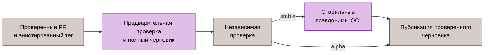

# Автоматизация CI и выпуска

[English original](../../en/reference/automation.md).

Выполнением workflow управляют команды Go. [.github/workflows/ci.yml](../../../.github/workflows/ci.yml), [security.yml](../../../.github/workflows/security.yml), [e2e.yml](../../../.github/workflows/e2e.yml) и [release.yml](../../../.github/workflows/release.yml) выбирают команды. Их реализуют [cictl](../../../test/cmd/cictl/main.go), [cirunner](../../../test/internal/cirunner/) и [toolbootstrap](../../../test/cmd/toolbootstrap/main.go).

Это контракты исходников. Наличие команды не доказывает приёмку кандидата и не разрешает удалённое изменение.

| Область | Закреплённый инструмент | Привязка |
|:---|:---|:---|
| Провайдер Podman Compose | [Compose 5.6.1](https://github.com/docker/compose/releases/tag/v5.6.1) | Проверенный bootstrap и образ разработки |
| Пакеты выпуска | [GoReleaser 2.19.0](https://github.com/goreleaser/goreleaser/releases/tag/v2.19.0) | Workflow выпуска и локальный `package-build` |
| SBOM модулей | [Syft 1.55.0](https://github.com/anchore/syft/releases/tag/v1.55.0) | Workflow выпуска и `cictl sbom` |
| Сканирование файловой системы | [Trivy 0.76.1](https://github.com/aquasecurity/trivy/releases/tag/v0.76.1) | CI завершается с отказом при CRITICAL/HIGH |

Пересобрать образ разработки после изменения pin Compose. Повторно проверить вывод сканеров, валидацию SBOM и жизненный цикл пакетов перед выпуском; одно обновление версии не квалифицирует результаты.

Runtime-[модуль](../../../go.mod), общий [модуль Go-инструментов](../../../tools/go.mod), изолированный [модуль gopls](../../../tools/gopls/go.mod), изолированный [модуль Syft](../../../tools/syft/go.mod) и управляемый [consumer GoReleaser](../../../tools/goreleaser/qualified.mod) имеют отдельные выбранные графы зависимостей. Образ разработки собирает `gopls` из собственного графа, сохраняя соответствующий API `golang.org/x/tools`. Замена `golang.org/x/net` на тот же модуль выбирает исправленную версию без изменения API-зависимости языкового сервера. Инвентаризация зависимостей включает все пять графов; см. [определения графов](../../../test/internal/dependencyinventory/go_tools.go).

Модуль инструментов объявляет `govulncheck` и `osv-scanner` директивами Go `tool`. [Аудит уязвимостей](../../../scripts/vuln-audit.go) запускает управляемые инструменты через `go tool -modfile=tools/go.mod`; отдельные версии команд не разрешаются. Перед каждым проходом OSV Go разрешает полный выбранный граф, включая пути и версии заменяющих артефактов. OSV получает этот набор в закрытом временном манифесте; `--report-dir` сохраняет выбранный вход и исходный отчёт для каждого графа. Обычный аудит runtime/tools/gopls/Syft отклоняет пустые или конфликтующие входы и все локальные замены. Отдельная команда `publisher-audit` допускает только аутентифицированные замены `../source` и `../refmt-local` в подготовленном workspace GoReleaser; все остальные локальные замены приводят к отказу. Ответ OSV должен точно покрывать выбранные пути и версии Go-модулей; отсутствующие, повторные и дополнительные пакеты приводят к отказу аудита. Сравнение покрытия допускает отсутствие начальной `v`, сохраняя исходные доказательства без изменения. Проверка фактических пакетов запрещает импорты legacy Distribution и пакеты, исключённые условиями module-only допусков. Успех обычного аудита четырёх графов не квалифицирует бинарники публикации и встроенные в них зависимости.

Общий [установщик Syft](../../../test/internal/cirunner/syft.go) собирает изолированный consumer с `CGO_ENABLED=0`, upstream-тегами Linux и метаданными из [профиля исходников](../../../internal/toolprofile/syft.go). Он проверяет checksum исходников и запускает проверку открытого исполняемого файла перед атомарной установкой. Сохранять символы для анализа уязвимостей бинарника. При отказе сборки удаляются только временные файлы с совпавшей идентичностью; подмена путей и неожиданные файлы в каталогах блокируют очистку.

## Обычные команды

| Команда | Контракт |
|:---|:---|
| `cictl build` | Собрать бинарники workflow фиксированными прямыми аргументами |
| `cictl lint` | 92 настроенных базовых линтера и 18 явных профилей тегов сборки |
| `cictl test-coverage` | Race-тесты gotestsum; JUnit, JSON и атомарное покрытие |
| `cictl commit-policy` | Передать PR_TITLE одним буквальным аргументом проверки качества репозитория |
| `cictl proto-verify` | Собрать закреплённые генераторы, перегенерировать, отклонить изменения protobuf среди tracked/staged/untracked |
| `cictl buf-fetch-base`, `buf-breaking` | Проверить GITHUB_BASE_REF, получить полный refspec, разрешить точный commit для Buf |
| `cictl sbom` | Восемь непустых отчётов файлов модулей: runtime/tools/gopls/Syft, каждый в CycloneDX и SPDX |

Фиксированные пути отчётов проверяются и очищаются до сбора. Неуспешная дочерняя команда сохраняет stdout/stderr и завершает шаг отказом; старый обычный артефакт не подменяет успешное выполнение. Сбор SBOM фиксирует инвентаризацию зависимостей, но не достижимость символов.

`toolbootstrap podman-runtime` проверяет закреплённый Go-провайдер Compose, Podman и jq. `podman-e2e` добавляет настройку размещённого runner и закрытый rootless-сокет API. Готовность сокета ограничена 20 секундами; она не доказывает исправность API. Существующий сокет используется без приобретения владения. При отказе bootstrap завершает и присоединяет только новую принадлежащую ему службу; диагностический журнал сохраняется. Публикация GITHUB_ENV/GITHUB_PATH — часть готовности. `apparmor-denials` оставляет в диагностике только строки запретов.

Исполняемые шаги CI остаются одиночными командами; многострочные shell-программы и явные объявления shell не требуются. Не помещать значения токенов в аргументы команд и сохраняемые артефакты; этап предложения использует описанный ниже временный файл учётных данных.

## Предложение выпуска

Вызывать `cictl release-please-pr` из [workflow предложения](../../../.github/workflows/release-please.yml). Выполнять job в закреплённом образе и устанавливать Go 1.27.3 существующим официальным setup action:

```text
docker.io/library/node:26.13.0-trixie-slim@sha256:e4db4c914bf8ad241bd24804fc25d272d89bad97e68cdc8a1414862790a02c39
```

Образ Slim содержит Node 26.13.0. Доверенный Ubuntu runner должен предоставлять публичный файл `/etc/ssl/certs/ca-certificates.crt`; workflow монтирует его read-only по тому же пути контейнера и задаёт `SSL_CERT_FILE` для HTTPS-загрузок Go. Trust store принадлежит платформе runner; его содержимое не является неизменяемым pin образа. Проверка целостности архивов и lock зависимостей остаются обязательными. Встроенный npm не выполняется. [tools/release-please](../../../tools/release-please/) изолирует upstream Release Please 17.11.2 и lock потребителя от runtime и Go-инструментов качества. Lock выбирает `@xmldom/xmldom` 0.8.15, handlebars 4.7.10, js-yaml 4.3.2, brace-expansion 5.0.12 и minimatch 11.0.3.

Go-компонент [установки bootstrap](../../../test/internal/npmbootstrap/install.go) получает три официальных архива registry, закреплённых в [bootstrap.json](../../../tools/release-please/bootstrap.json): npm 12.2.1, undici 6.29.1 и ip-address 10.7.4. Он проверяет SHA-512, размер сжатого архива, пути обычных файлов, число записей и распакованный размер. До исполнения заменяются два поддерева встроенных зависимостей и применяется закрытое [исправление minimatch](../../../test/internal/npmbootstrap/repair.go): перенос upstream [77a0f5c4b80bdc641c3c930a1d9edf5ad2db57f8](https://github.com/isaacs/minimatch/commit/77a0f5c4b80bdc641c3c930a1d9edf5ad2db57f8) в оба формата модулей и выбор существующих точек входа `glob/raw`. Проверять хеши каждого исходного и производного файла; отклонять отсутствие файлов или изменение содержимого. Сохранять фактические версии встроенных пакетов и отдельно указывать исходный архив и производные файлы. Lock потребителя Release Please выбирает minimatch 11.0.3 для git-file-utils 3.2.1; эта замена не изменяет встроенный matcher npm. Контракт определяет установку артефактов; разрешением и установкой зависимостей владеет npm. Аудит пакетов не подтверждает отсутствие уязвимостей в OCI base.

1. Скопировать проверенные манифест, lock, `.npmrc` и контракт bootstrap в принадлежащий запуску временный каталог. Установить проверенный bootstrap npm до запуска Node. Обеспечить точные Node/npm engines через `engine-strict=true`.
2. Вызывать приватный entrypoint npm через Node: выполнить `ci --ignore-scripts` по замороженному lock, затем `audit`. Сравнить digest всех четырёх скопированных входов до и после выполнения; отклонить отказы установки, изменение входов или отказы аудита до чтения токена GitHub.
3. Создать файл токена с правами `0600` внутри принадлежащего запуску каталога `0700`. Передавать существующее абсолютное имя файла через upstream `--token=<file>`; не копировать значение токена в аргументы и окружение дочерних процессов.
4. Выполнить upstream `release-pr` для `dantte-lp/gobfd`, target `release/v1.0`, с конфигурацией и манифестом из репозитория. Сохранить `skip-github-release: true` и `skip-changelog: true`; вручную отобрать записи обоих changelog в полученном PR.
5. Размещать `NODE_COMPILE_CACHE` внутри принадлежащего запуску каталога. Удалить токен, compile cache и каталог при успехе и отказе. Сохранять только диагностику без секретов; не подавлять отказы дочерних команд и очистки.

Go владеет оркестрацией. Node запускает upstream npm и [CLI Release Please](https://github.com/googleapis/release-please/blob/v17.11.2/docs/cli.md); JavaScript, shell или Python launcher проекта не добавляется. Основные Go-проверки качества не меняются. Завершить API- и OCI-квалификацию точного кандидата до поставки; успешные изолированные проверки установки, аудита и help не подтверждают готовность публикации.

## Бенчмарки

`benchmark-pair` собирает десять чередующихся пар base/head, по одному образцу без race длительностью 100 мс на вызов для BFD/netio. Каждому пакету и имени нужны ровно десять валидных образцов с каждой стороны. Каждый вывод ограничен потоковым пределом 64 MiB; совпадающие по файловому объекту пути вывода и символические ссылки отклоняются. Отделённый worktree базовой версии создаётся один раз под RUNNER_TEMP и удаляется с ограниченным контекстом, устойчивым к отмене. Ожидание каналов дочернего процесса ограничено 30 секундами.

`benchmark-run`, `benchmark-base` и снимки выпуска сохраняют шесть запусков без чередования. `benchmark-normalize` сопоставляет только три исторических псевдонима и требует RecvDecodeLookupEnqueue, RecvDecodeFSM и TxMarshalJitter с обеих сторон. `benchmark-report` проверяет оба исходных входа, разбирает CSV benchstat и атомарно публикует Markdown, экранированный HTML, исходные CSV и примечания, а также версионированный JSON. Регрессии time/op не менее 10% для именованных критических бенчмарков приводят к отказу команды, когда base или head достигает порога 100 ns/op; другие регрессии только для отчёта используют 1 ns/op. Отчёты доступны и при критическом отказе. Ошибки сводки шага и предупреждений передаются вызывающей стороне; отсутствие получателя предупреждений или пропуск сводки выпуска не обходят критическую проверку. Некорректный или отсутствующий сбор и фактический отказ benchstat также приводят к отказу. См. [бенчмарки](../12-benchmarks.md).

## Последовательность выпуска



Release Please создаёт только предложение с `skip-github-release: true`; проверенный PR содержит отобранные записи обоих changelog и манифест версии. Сопровождающий отправляет точный аннотированный тег. Последовательность разделяет сборку, независимую проверку доказательств и завершающую публикацию. Только стабильный выпуск меняет псевдонимы. Сохранять точного кандидата и останавливаться на первом неуспешном этапе.

| Команда | Проверка или изменение |
|:---|:---|
| `release-preflight` | Канонический стабильный или разрешённый alpha-тег, аннотация, репозиторий, точный HEAD ветки выпуска; отклонить существующие выпуск, черновик и версионные теги OCI |
| `release-notes` | Опубликованные стабильные выпуски с пагинацией, полный диапазон обслуживания, фактические даты; неизменяемые ссылки |
| `release-pr-check` | После примечаний: точные слитый PR, база и commit, версия манифеста и оба датированных заголовка changelog; добавить проверенный URL PR |
| `release-build` | Четыре бинарника с метаданными GITHUB_REF_NAME/GITHUB_SHA |
| `release-upx` | Точные размер и хеш архива, полная проверка записей tar, привязанная версия исполняемого файла; публикация PATH в ограниченном корне |
| `release-syft` | Собрать и проверить изолированный consumer; `--compiler-container` использует готовый host-контроллер с ненулевым UID и закреплённый образ компилятора |
| `release-goreleaser` | Собрать и проверить управляемый publisher закреплённым native Go toolchain; сборка пакетов требует его привязанный бинарник |
| `release-source-tools --compiler-container` | Проверить и собрать Syft и GoReleaser в отдельных закреплённых compiler workers; опубликовать оба PATH после проверок и очистки |
| `publisher-audit` | Подготовить один аутентифицированный workspace publisher, собрать артефакт и проверить тот же выбранный граф до очистки |
| `release-test-report` | Race-тесты и существующие пути JUnit/JSON/HTML |
| `release-benchmarks`, `release-benchmark-metadata` | Шесть образцов BFD/netio; commit, версия, UTC, Go и число запусков |
| `release-benchmark-comparison` | Новое сравнение в text/HTML/Markdown/CSV/примечаниях/структурированном виде при наличии baseline.txt; иначе очистить старые выходы и пропустить сравнение |
| `release-reports-archive` | Копия доказательств в ограниченном корне и архив отчётов; у производителя нет общего предела размера или числа записей |
| `release-artifacts` | Независимая проверка исходников и commit, отчёты точного ожидаемого набора артефактов |
| `release-assets-upload` | Загрузка основных артефактов, привязанных к отчётам, без перезаписи |
| `release-oci-evidence` | Оба версионных индекса, amd64/arm64, SPDX и связанные аттестации SLSA v1 |
| `release-evidence` | Хешировать снимки отчётов и digest, загрузить дополнительные доказательства |
| `release-verify` | Повторно проверить идентичности, признаки draft/prerelease, тело и ровно 12 артефактов; скачать и семантически проверить те же хешированные байты |
| `release-promote` | Только stable; отклонить alpha, сохранить снимок псевдонимов, скопировать проверенный индекс, считать дескрипторы; ограниченный откат при отказе |
| `release-publish` | Финальные проверки идентичностей, артефактов и digest, закрытие корней, завершающая публикация; alpha использует `--prerelease --latest=false` |

Job выпуска компилирует `cictl` внутри закреплённого [образа компилятора](../../../internal/toolprofile/compiler.go) до входа в registry. Host с ненулевым UID запускает `release-source-tools --compiler-container`. Отдельные ограниченные workers собирают Syft и GoReleaser из аутентифицированных исходников. Host проверяет открытые бинарники, происхождение исходников и метаданные версии, удаляет временные файлы и одной транзакцией публикует оба абсолютных каталога бинарников в `GITHUB_PATH`. Установки остаются вне `dist`; сборка пакетов повторно использует привязанный исполняемый файл publisher.

[Профиль publisher](../../../tools/goreleaser/source.json) закрепляет исходные checksum GoReleaser и Refmt, две проверенные миграции import и три пары manifest. Управляемый consumer разрешает только `../source` и `../refmt-local` как локальные модули. Команды инвентаризации и security используют одну проверяемую структуру workspace; отклонять изменённые файлы, посторонние замены и ошибки очистки.

Запускать этот bootstrap только на новой GitHub-hosted Ubuntu VM. Компилятор имеет deadline 600 секунд и 5 секунд до принудительного завершения; job выпуска имеет deadline 60 минут. Удаление hosted VM ограничивает время жизни bootstrap-контейнера, оставшегося до старта при аварийном завершении CLI; очистка временного каталога runner либо удаление VM устраняет оставшийся bootstrap-файл. Постоянный runner требует отдельного владельца жизненного цикла. Эти контракты исходников не подтверждают приёмку hosted-публикации.

GoReleaser создаёт черновик с отключённой основной загрузкой, `prerelease: auto` и `make_latest: false`. Продвижение стабильного latest отложено до проверенной финальной публикации. Alpha сохраняет стабильные GitHub latest и псевдонимы OCI. Финализация нативных пакетов заменяет программы жизненного цикла RPM и обновляет контрольные суммы и манифесты. Матрица артефактов требует два Linux-архива, четыре пакета DEB/RPM, два CycloneDX SBOM, соответствующих архивам, и контрольные суммы; отчёты, digest OCI и дополнительные отчёты контрольных сумм завершают 12 удалённых имён.

Проверяющий компонент использует отдельный checkout точного SHA workflow без постоянных учётных данных. Он привязывает пути исходного workspace к открытым корням и предварительным отчётам. Строгий JSON отклоняет невалидный UTF-8, повторяющиеся или неканонические поля контракта и небезопасные пути. Загрузки отклоняют отсутствующие, лишние, связанные ссылками, пустые или слишком большие файлы. Разбор архива отклоняет лишние элементы gzip, хвостовые данные, небезопасные или повторяющиеся записи, ссылки и специальные файлы.

[Производитель](../../../test/internal/cirunner/release.go) очищает выходы сравнения до проверки `testdata/benchmarks/baseline.txt` и упаковывает отчёты без общего предела выхода. Последующий проверяющий компонент ограничивает [сжатый артефакт](../../../test/internal/cirunner/release_download.go) 64 MiB, а [архив отчётов](../../../test/internal/cirunner/release_asset_content.go) — 256 MiB в распакованном виде и 4096 записями. Эти ограничения проверяющего компонента не ограничивают создание архива.

Доказательства OCI запрашиваются по неизменяемому digest индекса. Основной digest и digest продукта Debian должны совпадать и содержать ровно linux/amd64 и linux/arm64 со связанными аттестациями. Git/Docker не получают токены GitHub. Публикация alpha повторно проверяет версионные OCI и не проверяет стабильные псевдонимы на совпадение с её digest. Откат стабильных псевдонимов проверяет восстановленные идентичности; после завершающей публикации нет следующего шага выпуска, способного завершиться отказом. Считывание после публикации и закрытие стабильной ветки остаются отдельными обязанностями сопровождающего.

<a id="inventory-зависимостей"></a>

## Инвентаризация зависимостей

[dependency-inventory.json](../../supply-chain/dependency-inventory.json) описывает выбранные графы runtime и инструментов, объявленные инструменты, Actions, OCI и исходники соседей. Генерация запрашивает доказательства лицензий точных версий через deps.dev; статические переопределения и координаты исходников остаются непроверенными без собственного наблюдения.

Снимок связывает свою эпоху наблюдения, источник, запрос, результат, хеш, владельца и дату проверки. Продвижение эпохи требует нового сбора. Проверка inventory отклоняет расхождение графа, числа пакетов, привязки исходников и объявлений. Go может скачивать аутентифицированные исходники publisher и выбранные модули, отсутствующие в кеше; работа этой проверки без сети не гарантируется. Незавершённые проверки выпуска требуют точного покрытия незавершённых категорий проверки в review_exception; отложенные и устаревшие решения сохраняют собственные границы. Ни перегенерация, ни успешная проверка inventory не предоставляют текущую безопасность upstream или приёмку стабильной линии.

## Процедура отказа

1. Сохранить точную команду, ревизию, ожидаемый список артефактов и исходную диагностику.
2. Проверить код выхода производителя до использования его файлов.
3. Отклонить устаревшие, частичные доказательства и доказательства с несовпадающей идентичностью.
4. Исправить отвечающие за результат исходники или команду и повторить неуспешную проверку на окончательном кандидате.
5. Сохранить явное незакрытое условие выпуска до появления фактического измерения.

[Разработка](../09-development.md), [процесс выпуска](../10-changelog.md), [стенд E2E](../../../test/e2e/README.md).
