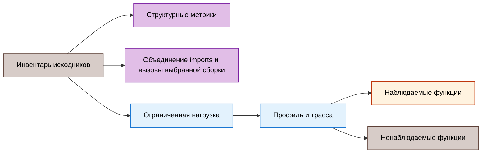

# RFC-CQ-0001: Стандарт качества кода и измерений

[English original](../../en/reference/code-quality-standard.md).

## Область применения

Стандарт проекта распространяется на собственные исходники Go, тесты и инструменты. Generated-код и варианты с ограничениями сборки входят в инвентарь с отдельными знаменателями качества. Текст регулирует [стандарт документации](documentation-standard.md). RFC-CQ-0001 — идентификатор проекта, не RFC IETF.

## Имена и контракты

Использовать имена пакетов в нижнем регистре, файлы `snake_case.go` и идентификаторы Go `MixedCaps`. Сохранять сокращения: `BFD`, `TTL`, `UDP`, `IP`, `RFC`, `ID`, `URL`, `API`, `CPU`, `TX`, `RX`. Исключить повтор имени пакета, общие пакеты `util` и синонимы существующего термина предметной области. Называть преобразования `Parse`, `Marshal`, `Unmarshal`, `Validate` или `Format` согласно операции. Операции желаемого состояния называть `Reconcile`; различать `Create`, `Register`, `Acquire`, `Close`, `Release` по владению. Сохранять грамматику веток `fix/vMAJOR.MINOR-<slug>` для поддерживаемой линии и английские Conventional Commits.

Передавать `ctx context.Context` первым параметром. Возвращать ошибки с контекстом и `%w`; классифицировать через `errors.Is` или `errors.As`. Проверять внешние данные до зависимых эффектов. Каждой goroutine назначить владельца, отмену и ожидание завершения. Для поведения протокола указать точный раздел RFC; правила имён не меняют wire format.

| Класс функции | Требование | Проверка |
|:---|:---|:---|
| Чистое преобразование | Одинаковые входы дают одинаковый результат; владение входом явно | Табличные/property-тесты; идемпотентность состояния не подразумевается |
| Reconcile желаемого состояния | Повтор сохраняет согласованное состояние и владение ресурсами | Повтор, дрейф, отказ и повторная попытка |
| Освобождение | Повтор не освобождает ресурс дважды | Повторный и конкурентный close |
| Событие, таймер, счётчик, RX/TX | Каждое принятое событие имеет заданный эффект и конечный учёт | Баланс, поколения и жизненный цикл |
| Без классификации | Вывод об идемпотентности отсутствует | Требуется явное ревью |

Не требовать идемпотентности накопительной обработки событий. Для состояния после сходимости действует `R(R(s,d),d)=R(s,d)`; равенство incidental timestamps и подавление ошибок не требуются. Восстановление после внешнего дрейфа — отдельное обязательство.

## Измерения аудита

Учесть каждую именованную функцию, метод и function literal: файл, строку, ограничения сборки, категорию generated/test и идентичность содержимого. Отдельно представить imports и вызовы. Декларация без ссылок — кандидат неиспользуемого кода: до удаления проверить интерфейсы, callbacks, reflection, CLI entrypoints, внешних потребителей и профили сборки.

Для каждой функции показать длину, ветвления, явную вложенность циклов, вызовы, goroutines и deferred work. Это структурные наблюдения, не доказательство Big-O или измерение аллокаций. Разделять точные совпадения токенов, структуру с переименованными локальными переменными и семантическое пересечение после ручного ревью. Общие формы RFC могут оправдывать повторение. Сохранить пороги lint и критические проверки бенчмарков; не заменять их произвольным общим баллом качества.

Отклонять пустой ввод, синтаксическую ошибку, повтор идентичности, недоступный файл, обход пути и изменение входа. Детерминированно сортировать отчёт. Публиковать полный набор входов и исключения. Проверить анализатор на переименованных переменных, разных receivers, closures, исключённых сборкой файлах и невалидных входах; измерять сам репозиторий Go-тестом.

Облегчённый fingerprint переименований не учитывает scope и сохраняет имена selectors/keys и литералы. Shadowing и типы требуют отдельного семантического ревью. Во всех знаменателях разделять production, tooling, тесты и generated-код. Несгенерированный вспомогательный код в `internal/testutil/` относить к tooling; файлы `_test.go` остаются тестами. Категории исходников описывают роли в репозитории, а не достижимость в бинарнике. Сложная функция tooling не является находкой о runtime hot path.

## Выполнить аудит

Использовать закреплённый контейнер разработки с подключённым репозиторием. Обычный поиск включает вложенные модули и исключает скрытые каталоги и корневые `vendor`, `node_modules`, `reports`, `bin`, `build`, `dist`. Каталоги предметной области, например `test/e2e/vendor`, сохраняются. Для точного tracked snapshot передать `--files=<path>` с Go-путями из `git ls-files`, разделёнными NUL. CLI отклоняет повтор и обход пути; ограничения: 10000 входов, 2 MiB на файл и 256 MiB суммарно. JSON содержит каждую функцию и хеш файла; Mermaid — объединение собственных imports, не вывод о циклах выбранной сборки.

```sh
mkdir -p reports
go run ./test/cmd/repoquality code --root . > reports/code-quality.json
go run ./test/cmd/repoquality code --root . --format=mermaid > reports/code-dependencies.mmd
go test -race -count=1 -v -run '^TestCode' ./test/internal/repoquality/
```

Тест печатает измеренный вектор качества и отклоняет отсутствие классификации или повтор идентичности функции. Сопоставлять кандидатов неиспользуемого кода между существующими профилями сборки и включать изолированный tools-модуль; одного корневого `./...` недостаточно. Сохранить исходные результаты инструментов, patch исходников и параметры запуска с датированными доказательствами аудита.

## Доказательства исполнения

Привязать измерение к исходникам, компилятору, хешу бинарника, нагрузке, ограничениям и команде. Разделять latency бенчмарка без инструментации, sampled CPU cost, scheduler trace и инструментированное включённое время. Издержки инструментации и вложенные вызовы запрещают суммировать inclusive time как общее время исполнения. Невызванные функции обозначать `not_observed`, не нулевой задержкой. Короткий сценарий не устанавливает универсальную скорость, отсутствие гонок или нативную ёмкость.

Измерять наблюдение RIB командой `go test -run '^$' -bench '^BenchmarkGoBGP' -benchmem -count=5 ./test/internal/interopcheck/` в закреплённом контейнере разработки. Запускать бенчмарки задержки отдельно от других нагрузок разработки. RIB cases проверяют полные снимки с 0, 1, 256 и 4096 каноническими IPv4 destinations и одним path у каждого destination; prefix cases измеряют разбор канонических IPv4 и IPv6. `b.Loop` исключает setup; проверка результата входит в измерение. Эти замеры исключают выполнение CLI, multipath-таблицы и обработку BFD-пакетов. Собирать CPU profiles и execution traces отдельным запуском, сохраняя соответствующий бинарник.

Импортировать полную CPU-таблицу `go tool pprof -top -nodecount=0 -nodefraction=0 -edgefraction=0 -unit=ns` через `--cpu=<path> --cpu-source=<recorded-source-sha256>`. До вывода отклонять несовпадение исходников, невалидные значения и неоднозначность символа между вариантами сборки. Хеш исходников — сохранённая оператором привязка, не аттестация происхождения бинарника; отдельно сохранить хеш бинарника и точную команду сбора. `cpu.flat_ns` и `cpu.cumulative_ns` — sampled totals, не ns/call. У несопоставленных деклараций сохраняется `cpu: null`. Closures, generic instantiations и специальные имена `main`/`init` могут остаться неразрешёнными; исходные профили сохраняют эти символы.



## Источники

- [Имена Go](https://go.dev/doc/effective_go#names), [спецификация Go](https://go.dev/ref/spec).
- [RFC 2119](https://www.rfc-editor.org/rfc/rfc2119), [RFC 8174](https://www.rfc-editor.org/rfc/rfc8174): нормативные термины при использовании прописных ключевых слов.
- [RFC 5880 §6.8](https://www.rfc-editor.org/rfc/rfc5880#section-6.8): обработка BFD и состояния.
- [Трассировка Go](https://github.com/golang/go/blob/go1.27.4/src/runtime/HACKING.md), [профилирование](https://pkg.go.dev/runtime/pprof).
