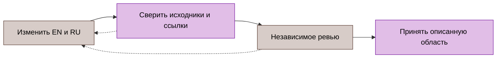

# Стандарт документации

Стандарт задаёт правила публикации документации GoBFD. Английская версия в `docs/en/` — каноническая; русская в `docs/ru/` сохраняет её технический смысл и относительные пути. Те же правила действуют для корневых документов об участии в проекте и выпуске. [Английский оригинал](../../en/reference/documentation-standard.md).

Ключевые слова MUST, MUST NOT, SHOULD, SHOULD NOT и MAY в верхнем регистре имеют значения из [RFC 2119](https://www.rfc-editor.org/rfc/rfc2119.html) с уточнением в [RFC 8174 §2](https://www.rfc-editor.org/rfc/rfc8174.html#section-2). Это требования проекта к документации, а не дополнительные требования к пакетам BFD. Слова в нижнем регистре используются в обычном значении.

## Назначение и владелец документа

Каждая страница решает одну задачу. Применять [категории Diátaxis](https://diataxis.fr/) внутри существующего дерева; классификация не требует перемещения или переименования файлов.

| Тип | Обязательное содержание |
|:---|:---|
| Учебное руководство | Начальное состояние, последовательное освоение, рабочий результат |
| Процедура или регламент | Предпосылки, ограниченная область, действия, ожидаемый результат, остановка и восстановление |
| Справочник | Точные поля, единицы, значения по умолчанию, валидация и совместимость |
| Объяснение или ADR | Контекст, решение, альтернативы, последствия и ссылки на источники |
| Статус выпуска | Датированная техническая область, принятые доказательства и остаток квалификации |
| Историческая запись | Исходная дата, идентичность исходников, условия измерений и ограничения |

Исполняемые задачи, зависимости, приоритеты и передача работы ведутся в трекере проекта. Публичная дорожная карта — датированная техническая проекция, а не вторая база задач. В актуальных руководствах, дорожных картах, changelog и release notes MUST NOT присутствовать внутренние ID задач, команды конкретного трекера, инструкции оркестрации, атрибуция помощника и стенограммы сессий. Замена удалённых ID непрозрачными кодами аудита не допускается. Использовать описание поведения, ссылки на исходники, разделы RFC или доступные публичные задачи.

Исторические исходные материалы, опубликованные разделы выпусков, юридические тексты и дословные материалы RFC и производителей MUST сохранять факты и происхождение. Удалять служебные метаданные из публикуемых производных документов только после сохранения оригинала и исправления использующих их документов и ссылок. Очистка истории не завершена, пока специфичные для инструментов файлы или ссылки отслеживаются в Git; этот стандарт не подтверждает их отсутствие.

## Декларативно-императивный стиль

Описывать поведение в настоящем времени: «Владелец фиксирует состояние до публикации события». Формулировать действия глаголом: «Сохранить активную конфигурацию. Применить кандидат. Проверить готовность». В русских процедурах последовательно использовать инфинитив; в английских — повелительную форму: “Record. Apply. Verify.”

Каждое предложение MUST содержать факт, действие или ограничение. Исключить из актуальных справочников первое лицо, обращения к читателю, рекламные утверждения и историю расследования. Раскрывать незнакомую аббревиатуру при первом употреблении. Сохранять канонические идентификаторы протоколов, API и конфигурации на английском. Определять термин один раз и использовать последовательно.

До изменения состояния процедура MUST задавать привилегии, поддерживаемую платформу, область воздействия и начальное состояние. Для каждого существенного шага указывать ожидаемый результат и условие остановки. Определять безопасность повторного выполнения; для создаваемых ресурсов задавать проверку принадлежности и очистку. Сохранять независимый путь восстановления, описывать возврат к принятому состоянию и его проверку. Успешное выполнение команды не доказывает достижение целевого состояния.

## Markdown и оформление

Использовать UTF-8, LF и перевод строки в конце файла согласно [EditorConfig](../../../.editorconfig). Использовать [GitHub Flavored Markdown](https://github.github.com/gfm/) с блочной семантикой [CommonMark](https://spec.commonmark.org/). Следующие решения — соглашения проекта.

| Элемент | Правило |
|:---|:---|
| Заголовки | Один H1 в обычном документе; H2–H4 без пропуска уровней и точки в конце |
| Интервалы | Одна пустая строка вокруг заголовков, списков, таблиц и блоков кода; без табуляции и пробелов в конце прозы |
| Списки | `-` для параллельных элементов; нумерация для последовательных действий; без исполняемых списков задач в Markdown |
| Таблицы | Начальная и конечная вертикальные черты; явное выравнивание; числа вправо; таблицы шире пяти колонок разделять |
| Код | Fenced-блок с языком; обратные кавычки для идентификаторов, путей, флагов и точных значений |
| Ссылки | Относительные пути внутри репозитория; содержательные HTTPS-ссылки на внешние источники |

Сохранять полезные якоря. Перед изменением заголовка с входящими ссылками добавлять явный совместимый якорь. Корневой README может сохранять существующее HTML-оформление; обычная документация MUST NOT зависеть от MDX, frontmatter сайта, вкладок или нестандартных уведомлений.

Для новых и изменяемых примеров использовать закрытый набор языков: `sh` для отдельных вызовов CLI, `text` для вывода или формул, `go`, `yaml`, `json`, `toml`, `ini`, `promql` и `mermaid` для соответствующего содержания. Не смешивать `bash` и `sh` для эквивалентных примеров команд. Многошаговая автоматизация репозитория реализуется на Go; не добавлять shell-скрипты и Python, принадлежащий репозиторию. Внешняя разовая диагностика не становится требованием продукта.

Открывающий fence содержит только язык. Содержательное название примера размещать в предыдущем предложении; не зависеть от отображения `title=` и `showLineNumbers`. Разделять команды и вывод, не добавлять приглашение shell, сохранять исполняемые отступы. Явно отмечать иллюстративные и невыполненные примеры.

## Требования, протокольные утверждения и источники

Различать требование протокола, факт реализации, измеренный результат и предлагаемое решение. Для нормативного требования указывать точный раздел RFC, проверять применимые обновления и errata. Для утверждения о реализации ссылаться на символ исходного кода или ближайший устойчивый раздел. Привязывать доказательства приёмки к точному commit и окружению. [RFC 7322 §4.8.6](https://www.rfc-editor.org/rfc/rfc7322.html#section-4.8.6) разделяет нормативные и информационные ссылки; оформление страниц остаётся соглашением проекта.

[Матрица RFC](../08-rfc-compliance.md) определяет статус реализации. Заглушка, unit-тест, короткий нагрузочный прогон или руководство производителя MUST NOT представляться как полное соответствие RFC, подтверждённый production-масштаб или приёмка совместимости. Сохранять отрицания, условия, известные отказы и границы preview в обоих языках.

Для Cisco, Arista, Juniper и Huawei ссылаться на раздел официального руководства, указывать физическую или виртуальную платформу, семейство и версию NOS, а также применимый режим. Использовать существующий [справочник производителей](vendor-bfd.md); руководство подтверждает поведение оборудования, а не успешный тест с GoBFD. До утверждения о совместимости зафиксировать фактический peer и версию, топологию, конфигурацию, пакетные доказательства и результат.

В самостоятельных иллюстративных примерах использовать адреса документации: IPv4 `192.0.2.0/24`, `198.51.100.0/24` или `203.0.113.0/24` из [RFC 5737 §3](https://www.rfc-editor.org/rfc/rfc5737.html#section-3), IPv6 `2001:db8::/32` из [RFC 3849 §2](https://www.rfc-editor.org/rfc/rfc3849.html#section-2) и зарезервированные домены из [RFC 2606 §§2–3](https://www.rfc-editor.org/rfc/rfc2606.html#section-2). Отдельно обозначать loopback, multicast и link-local, когда требуется их фактическая семантика. Не публиковать реальные учётные данные и закрытые эксплуатационные идентификаторы.

Исполняемый пример для лаборатории из репозитория MUST сохранять точные адреса тестового окружения и ссылаться на его конфигурацию. Обозначать фиксированные лабораторные сети и требовать проверки пересечений до запуска; замена адресов только в документации нарушает соответствие процедуры исходникам. Это соглашение проекта не разрешает использовать закрытые адреса рабочего окружения в иллюстративных примерах.

Записывать даты как `YYYY-MM-DD`; для наблюдений использовать временные метки [RFC 3339 §5.6](https://www.rfc-editor.org/rfc/rfc3339.html#section-5.6) с явным смещением, предпочтительно UTC `Z`. Каждая длительность и граница MUST иметь единицу. Различать единицы конфигурации и кодирования в пакетах, номинальные формулы и измеренные распределения; не выводить гарантированное время обнаружения отказа из номинальной формулы таймера.

## Диаграммы Mermaid

Использовать Mermaid для владения, движения пакетов, топологии, обмена сообщениями и жизненного цикла. Значения представлять таблицами. Диаграмма MUST показывать одну связь и сопровождаться текстом, понятным без её отображения. Добавлять [доступное название и описание](https://mermaid.js.org/config/accessibility.html) через `accTitle` и `accDescr`, если они поддерживаются выбранным типом диаграммы.

| Предмет | Диаграмма |
|:---|:---|
| Владение или топология | `flowchart LR` |
| Иерархия или решение | `flowchart TD` |
| Обмен протокольными сообщениями | `sequenceDiagram` |
| Жизненный цикл состояния | `stateDiagram-v2` |

Ограничивать flowchart 30 узлами. Заключать подписи в кавычки, использовать устойчивые идентификаторы и различать фактическое движение (`-->`) и логическую зависимость (`-.->`). Передавать смысл направлением и текстом, а не только цветом. Использовать в flowchart зарегистрированные ниже классы; дополнительный класс сначала регистрировать здесь. Sequence и state сохраняют собственную нотацию.

| Класс | Значение | Заливка | Контур | Текст |
|:---|:---|:---|:---|:---|
| `srv` | Демон или владелец сессии | `#e1bee7` | `#7b1fa2` | `#000` |
| `mgt` | Управление или конфигурация | `#d7ccc8` | `#5d4037` | `#000` |
| `leaf` | Пакетный I/O или устройство | `#e3f2fd` | `#1976d2` | `#000` |
| `brt` | Peer или актуатор маршрутизации | `#fff3e0` | `#bf360c` | `#000` |
| `vrf` | Контекст виртуальной маршрутизации и пересылки | `#ede7f6` | `#512da8` | `#000` |

Например, решение о публикации зависит от сверки исходников и независимого ревью; неуспешная проверка возвращает документ к правке.

Отобразить изменённые диаграммы в целевом просмотрщике, проверить подписи, стрелки и контраст. Проверку исходного текста или ссылок MUST NOT выдавать за успешное визуальное отображение.

## Changelog и публичный статус разработки

Следовать [Keep a Changelog](https://keepachangelog.com/en/1.1.0/) и существующему [регламенту выпуска](../10-changelog.md). Поддерживать смысловую эквивалентность корневых EN/RU changelog, размещать новые записи выше старых, группировать заметные пользователю изменения по применимым категориям Added, Changed, Deprecated, Removed, Fixed или Security и их русским соответствиям. Отделять невыпущенные изменения от датированных выпусков.

Описывать условие, итоговое поведение, влияние на совместимость и необходимое действие оператора. Удалять внутренние ID задач и историю исполнения; сохранять доступные публичные задачи, advisory, точные версии и необходимые ограничения. Changelog не является выгрузкой commit или журналом закрытия задач. Сохранять опубликованные разделы; при необходимости изменения смысла добавлять датированную поправку.

Публичный статус разработки описывает возможности и остаток технической квалификации обычными терминами. Подробные задачи, оценки и изменения приоритетов остаются в трекере. Новый стандарт документации MUST NOT представляться доказательством соответствия всех существующих документов.

## Перевод и приёмка

Сначала изменять английский оригинал, затем русский перевод в том же изменении. Сохранять эквивалентность путей, ссылок, примеров, чисел, единиц, силы требований, исключений и статуса; переводить прозу и читаемые подписи диаграмм. Добавлять ссылку на вторую версию. Сохранять исторические оригиналы и различать поправку перевода и новое утверждение о реализации.

Перед приёмкой изменения документации:

1. Сверить каждое изменённое техническое утверждение с исходниками, RFC или официальным руководством производителя.
2. Проверить оба языка, идентификаторы, единицы, ссылки и сохранённые якоря; искать внутренние ID задач наряду с названиями и командами трекера.
3. Выполнить существующую проверку `make lint-docs` в квалифицированном окружении, записать фактическое число входных файлов и код завершения. Проверить diff на пробелы и непреднамеренные изменения вне документации.
4. Проверить отображение изменённых диаграмм и применимых примеров; зафиксировать невыполненные команды и непроверенное отображение.
5. Получить независимое ревью точного финального diff, устранить замечания, проверить принятый commit и чистоту рабочего дерева.

Существующая проверка Markdown охватывает отдельные структурные правила; она не подтверждает стиль прозы, полную корректность относительно кода, доступность внешних URL, отсутствие внутренних ID или визуальное отображение. Фиксировать эти проверки отдельно. Использовать существующие инструменты на Go; стандарт прозы не вводит runtime-зависимость и не разрешает публикацию.
