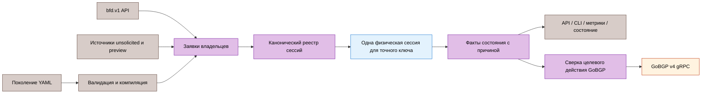

# Контракт промышленной эксплуатации

Статус: принятые требования v1 с датированными поправками; реализация и окончательная квалификация учитываются отдельно. Метки возможностей ниже обозначают цель выпуска, а не сертификацию текущего исполняемого файла. [Английский оригинал](../../en/reference/production-contract.md).

Источник: проект промышленной эксплуатации от 2026-08-18 в снимке репозитория `c5bcbfcb7e058a5a7f22b8a6811c8e4250963d50`, Git blob `8aa7c8c00e54ecd7160986edd5ec8a2732c1d61e`. Полный оригинал сохраняется в неизменяемой истории Git. Здесь сохранены технические требования; историческая последовательность выпусков и заменённые фиксации зависимостей описаны в [записях решений](design-records.md). [Матрица RFC](../08-rfc-compliance.md) определяет текущий статус реализации, [дорожная карта](../roadmap.md) — датированное состояние квалификации.

Решение 2026-10-13 выбирает GoBGP v4.10.0 вместо исходного v4.8.0; v3 `/apipb.GobgpApi` и v4 `/api.GoBgpService` несовместимы. Решение 2026-10-21 разрешает точное исключение `GO-2026-4736` только на уровне модуля при четырёх условиях раздела [актуатора GoBGP v4](#gobgp-v4-actuator). Поправка 2026-10-20 ставит v1 первым в поставке, сохраняя все нормативные требования и обязательные проверки безопасности, масштаба, OCI и качества. Даты и версии идентифицируют решения; свежая проверка версий upstream или advisory здесь не заявляется. [Риски зависимостей](dependency-risk.md) описывают выбранный граф и политику исключений.

Поправка измерений 2026-08-27 переименовывает измеряющий только постановку в очередь benchmark в `BenchmarkRecvDecodeLookupEnqueue`; он не доказывает сквозную скорость обработки пакетов или независимость от GC. Обязательны измерения задержки от UDP до фиксации состояния FSM, ошибки таймера, ложных Down и учёт потерь.

## Контракт продукта

GoBFD v1 — самостоятельный демон BFD со стабильным асинхронным ядром BFD, безопасным управлением с приоритетом локального доступа, сверкой целевого состояния с сохранением границ владения, наблюдаемым внешним управлением и воспроизводимыми доказательствами совместимости. GoBFD не является участником BGP, CNI, контроллером Kubernetes, RIB, FIB или владельцем маршрутов.

Наличие кода не доказывает соответствие протоколу. Каждая стабильная возможность требует нормативных пакетных тестов и актуальных проверок взаимодействия с FRR/BIRD. Возможность без пройденной проверки остаётся явно preview и выключена по умолчанию, даже при наличии сообщений API.

## Правила совместимости

- Существующие сообщения `bfd.v1` и номера полей остаются декодируемыми.
- Существующие ключи YAML распознаются; устаревающие небезопасные значения дают точную ошибку валидации вместо отказа позднее в runtime.
- Новые поля и RPC добавляются без замены существующих; старые клиенты продолжают использовать Add, Delete, Get, List и Watch.
- `withdraw-routes` распознаётся для диагностики миграции, но отклоняется как неподдерживаемый и не входит в контракт v1.
- Интеграция GoBGP использует выбранную фиксированную версию API v4; стабильный v1 требует выбранный совместимый v4 с исправлением. Для GoBGP v3.37.0 сохраняется поддерживаемая линия v0.6.x; исполняемый файл v1 не содержит два сгенерированных API GoBGP.
- Эксплуатационные значения по умолчанию могут стать безопаснее: Unix-сокет для нового локального управления, запрет удалённого незашифрованного управления, метрики на loopback и preview для незавершённых расширений.

## Стабильные и предварительные возможности

| Возможность | Статус v1 | Условие выпуска |
|:---|:---|:---|
| Асинхронное ядро RFC 5880 | stable | Пройдены проверки Poll/Final, таймеров, аутентификации, диагностики, демультиплексирования и AdminDown |
| Single-hop RFC 5881 на интерфейсах множественного доступа с назначенными адресами | stable | Пройдены проверки IPv4/IPv6, портов, привязки источника и TTL |
| Общие интервалы RFC 7419 | stable | Пройдены существующие модульные тесты и проверки таймеров с FRR/BIRD |
| Multihop RFC 5883 | stable в заданной области | Пройдены проверки настраиваемой политики числа переходов и безопасности, запрета Echo, рекомендаций аутентификации и 1/2/5 переходов |
| Обработка удалённого бита Demand | Поведение стабильного ядра | Пройдены проверки прекращения периодического Control, Poll и семантики отказа; локальный запуск Demand не поддерживается |
| Настраиваемая пассивная роль | Стабильный режим производителя только для multihop | Пройдены активные и пассивные проверки FRR/BIRD; исключён из заявлений по RFC 5881 |
| Большие пакеты RFC 9764 | stable только после совместной проверки возможностей | Пройдены проверки пакетов с заполнением, с аутентификацией и без неё |
| Unsolicited BFD RFC 9468 | preview до перевода в стабильный статус | Пройдены проверки реальной подсети интерфейса и очистки |
| Unaffiliated Echo RFC 9747 | preview до перевода в стабильный статус | Пройдены проверки модели FSM, демультиплексирования и аутентификации RFC 5880 и пакетные тесты |
| Micro-BFD RFC 7130 | experimental | Выполнены требования интерфейса участника и multicast L2 |
| VXLAN BFD RFC 8971 | experimental | Пройдена проверка обязательного внутреннего пакета и демультиплексирования по VNI |
| Geneve BFD RFC 9521 | experimental | Пройдены проверки VAP, VNI, внутреннего пакета и работы нескольких VNI |
| Cease/10 RFC 9384 | Не реализовано | Upstream GoBGP предоставляет требуемый подтип в пакете |

Локальный режим Demand, affiliated Echo, S-BFD, P2MP BFD, MPLS/PW BFD и общая автоматизация graceful restart исключены из стабильного контракта v1.

## Архитектура



Целевое владение, исполнение физической сессии, наблюдаемые факты и внешние действия разделены. Перезагрузка конфигурации не может удалить сессию, созданную через API; потерянное событие не может навсегда потерять требуемое действие GoBGP.

## Каноническая идентичность и владение

Ключа `(peer, local, interface)` недостаточно. Канонический ключ v1:

```text
SessionKey{type, address_family, peer, local, interface, network_scope,
transport_scope}
```

`network_scope` обозначает сетевое пространство имён процесса в v1. Управление несколькими VRF внутри процесса отложено. Процессы в разных пространствах имён могут независимо использовать одинаковые адреса.

`transport_scope` — точное типизированное значение: пустое для базового BFD, интерфейс участника для Micro-BFD либо владелец инкапсуляции и backend с кортежем VNI/VAP для VXLAN/Geneve. Шаблонное соответствие запрещено. Одинаковые внешние адреса при разных backend, VNI или VAP обозначают разные сессии.

Источники сессий создают заявки владельцев, а не физические сессии. ID владельцев включают `config`, `api:<principal>`, `unsolicited`, `micro:<group>`, `vxlan:<name>` и `geneve:<name>`. Совпадающие заявки с одинаковыми действующими параметрами разделяют один дискриминатор и физическую сессию. Конфликт параметров даёт детерминированную ошибку; правило «первый запрос победил» запрещено. Освобождение последней заявки отправляет AdminDown и уничтожает физическую сессию.

Статус показывает настроенные и действующие значения, источники владельцев, целевое и применённое поколения, состояние ожидания или ошибки. Переданные пользователем строки владельца API не считаются доверенной идентичностью для авторизации. Сервер определяет стабильный транспортный субъект доступа: UID peer для Unix-сокета по умолчанию, настроенную идентичность для аутентифицированного совместимого listener на loopback либо настроенную идентичность SAN/SPIFFE для mTLS. Явно включённый переходный режим анонимных изменений через loopback разделяет явно небезопасный домен доверия `api:local`. Заявки переживают переподключение того же субъекта; экземпляр соединения никогда не является владельцем, один субъект не может освобождать заявки другого.

## Конфигурация и сверка состояния

Перезагрузка конфигурации содержит две фазы:

1. Разобрать и проверить полный кандидат, разрешить профили и скомпилировать его без изменения runtime.
2. Опубликовать целевое поколение и сверить только заявки, принадлежащие этому источнику.

Пустой набор `sessions` освобождает все заявки `config` и ничего больше. Отсутствующие интерфейсы дают `pending` с автоматической активацией после появления ресурса. Недопустимый кандидат не меняет предыдущее целевое поколение.

Глобальные операции с сокетами и ядром не могут быть атомарной транзакцией. Валидация атомарна, сверка заявок детерминирована, работающие сессии с последним заведомо исправным состоянием сохраняются там, где это безопасно. Каждое применение возвращает квитанцию с `created`, `updated`, `released`, `pending`, `failed`. Частичное применение видно как устаревшая readiness и никогда не записывается как успех.

Именованные профили — добавляемые объекты YAML/API с полями, различающими наличие значения. Явное `false`, нулеподобные значения по умолчанию и наследование различаются. Обработка изменения зависит от поля; обновления таймеров RFC 5880 используют нормативную матрицу четырёх вариантов, а не общее правило «применить после Final»:

- В Up увеличение Desired Min TX и уменьшение Required Min RX объявляются через Poll/Final; только соответствующий эффект откладывается до Final.
- Уменьшение Desired Min TX и увеличение Required Min RX имеют немедленный эффект по RFC при внутренне согласованных объявляемом значении и состоянии Poll.
- Минимальный TTL применяется на месте на определённой границе обработки принятого пакета. Множитель обнаружения действует так же вне удалённого Demand; при активном удалённом Demand он меняется через последовательность Poll, поскольку меняет следующий пакет Control.
- Перекрытие принимаемых ключей и выбор передающего ключа используют отдельный переход цепочки ключей.
- Включение или выключение аутентификации требует явного синхронизированного перехода и отклоняется как обычная горячая перезагрузка конфигурации.
- Роль, адрес, интерфейс, тип, сетевой и транспортный контексты заменяют заявку через контролируемое уничтожение и создание сессии.

Только изменения класса Poll обещают неизменный дискриминатор и непрерывное состояние Up.

[Транзакции таймеров](timer-transactions.md) определяют утверждённую очередь с одним активным и одним последним ожидающим предложением, отмену, истечение срока, восстановление и квитанции. [ADR-0006](../adr/0006-session-preserving-reload-policy.md) определяет принятое расширение на пять полей. Утверждение проекта и локальные проверки не заменяют фактическую квалификацию взаимодействия с peer.

## Исправления ядра RFC

До стабильного v1 обязательны следующие свойства:

- Изменения локальных таймеров и переход с медленного на быстрый режим инициируют последовательности Poll. При встречном Poll локальный Poll временно приостанавливается, передаётся только `P=0,F=1`, затем продолжаются ожидающие локальные изменения. Ни один пакет не может одновременно устанавливать `P=1` и `F=1`. Принятый Final завершает только последовательность с успешно отправленным Poll; неудачные отправки и ответы только с Final не дают этого подтверждения, новая последовательность не может переиспользовать его.
- Изменение удалённого `Required Min RX` пересчитывает таймер TX и вызывает немедленный пакет Control, когда этого требует RFC.
- Диагностика фиксируется до логов, уведомлений, метрик и немедленных пакетов, сохраняя диагностическое значение причины у всех потребителей.
- По Held Erratum 5205 RFC 5880 истечение таймера обнаружения уже в Down сохраняет Down, но меняет диагностику на Control Detection Time Expired; локальная диагностика сохраняется при переходах в Up по Held Erratum 7240.
- `RemoteDiscr` и состояние приёма аутентификации сбрасываются на каждом требуемом пути истечения таймера.
- Ожидающий Final сохраняется до успешной передачи либо завершения сессии.
- Стабильный RFC 5881 явно ограничен интерфейсами множественного доступа с назначенными адресами; начальное демультиплексирование point-to-point независимо от источника отложено.
- Заполнение RFC 9764 с аутентификацией проверяется по правильной длине BFD PDU.
- Настроенное заполнение с аутентификацией менее минимальных 26 октетов RFC 9764 отклоняется; реальный путь UDP доказывает нулевое заполнение, неизменный BFD Length и IPv4 DF.
- AdminDown передаётся повторно до успешной отправки или предельного срока остановки. Передача Control продолжается не менее согласованного Detection Time каждой сессии, если явный предельный срок вызывающей стороны позволяет. Сокращённое завершение сообщает о неполноте, а не об успехе.
- Каждый запрошенный AdminDown фиксируется циклом событий сессии с подтверждением либо явным истечением срока или ошибкой; резервный путь только через атомарную запись исключён, кешированное состояние, таймеры, пакеты, уведомления и экспортируемое состояние не расходятся.
- Когда обе стороны Up и peer устанавливает Demand, периодические пакеты Control подавляются с требуемым поведением Poll. GoBFD никогда не устанавливает локальный бит Demand; локальный режим Demand не поддерживается.

Для критического пути действует отдельный контракт доставки. Демультиплексирование возвращает типизированный результат: `accepted`, отклонение парсером, аутентификацией или TTL, неизвестная сессия, полная очередь либо закрытая сессия. Потеря при постановке в очередь не считается успехом. Каждый результат увеличивает ограниченный счётчик причин; ограниченная перегрузка допускает сброс пакетов, но не невидимую потерю или ложную успешную доставку. Уведомления состояния — версионированные факты; медленный Watch получает маркер разрыва поколений и синхронизируется по снимку. Управление маршрутизацией не полагается на доставку отдельных событий без гарантий: оно сверяет текущие целевые и применённые состояния до сходимости.

Файлы RFC в `docs/rfc/` побайтно совпадают с RFC Editor. Матрица соответствия строится по пройденным проверкам возможностей, а не наличию файлов или типов.

## Ограниченное демпфирование маршрутизации

Существующие ключи YAML демпфирования распознаются, но оно не скрывает факты BFD или первое действие по подходящему Down. Каждый переход состояния публикуется немедленно; первый Down сразу отключает управляемый peer. После превышения настроенного `suppress_threshold` разрешено удерживать только включение при восстановлении и избыточные вызовы актуатора, пока peer отключён. Штраф уменьшается по `half_life`; восстановление освобождается ниже `reuse_threshold` либо по `max_suppress_time`, когда механизм сверки применяет текущее целевое состояние независимо от оставшегося штрафа. Новый Down при удержанном восстановлении отменяет его и сохраняет отключённое состояние.

Это ограниченный гистерезис действий маршрутизации, а не подавление пакетов RFC 5882. Статус и метрики показывают штраф, состояние подавления, удерживаемое целевое действие и предельный срок. Недопустимые или нулевые границы отклоняются при валидации кандидата вместо создания бессрочного подавления.

## Причины событий и потребители маршрутизации

`StateChange` получает дополнительные наблюдаемые поля: удалённое состояние и диагностику, локальный и удалённый C-bit, причину (`remote_admin_down`, `remote_down`, `detection_timeout`, `local_admin`, `path_down`, `configuration`), целевое и применённое поколения.

Политика GoBGP по умолчанию:

| Причина | Результат BFD | Действие GoBGP |
|:---|:---|:---|
| Удалённый AdminDown | Down | Нет |
| Локальный AdminDown | AdminDown | Нет |
| Истечение таймера обнаружения | Down | Отключить управляемый peer |
| Обычный удалённый Down | Down | Отключить управляемый peer |
| Локальный отказ пути | Down | Отключить управляемый peer |
| Восстановление в Up | Up | Включить только при принадлежащем GoBFD соответствующем отключении |

Это соответствует независимо проверенному различию FRR/BIRD между удалённой административной остановкой и отказом пересылки. Полная политика C-bit/graceful restart отложена; v1 хранит и показывает оба C-bit и декларирует возможность `hard-fail` по умолчанию.

<a id="gobgp-v4-actuator"></a>

## Актуатор GoBGP v4

Клиент собирается с выбранной фиксированной версией v4 в `go.mod`. Поскольку публичный API не предоставляет надёжную семантическую версию и сервер не включает gRPC reflection, запуск выполняет вызовы без побочных эффектов для каждого требуемого RPC v4 и отклоняет `Unimplemented` или несовместимые ответы. Конфигурация задаёт ожидаемую основную версию, объявленную оператором; неизменяемое окружение совместимости независимо проверяет точную версию исполняемого файла GoBGP. Исходящий TLS поддерживает CA, имя сервера, клиентский сертификат и ключ.

Актуатор сверяет целевое и применённое состояния каждого peer. Ошибки RPC повторяются с ограниченной экспоненциальной задержкой и случайным разбросом. Дублирующиеся события BFD и события не по порядку безопасны, поскольку текущее целевое состояние имеет приоритет. Успешное отключение создаёт квитанцию владения, действующую только в текущей эпохе процесса. GoBFD никогда не включает peer, которого не отключал. После перезапуска автоматическое включение отключённых peer запрещено, поскольку GoBGP не доказывает последнего владельца изменения. Необязательная одноразовая операция принятия владения явная, аутентифицированная, аудируемая и выключена по умолчанию; сохранённые квитанции сами по себе не дают полномочий. Каждый запрос управления содержит один проверенный непустой канонический адрес peer; поведение GoBGP с пустым адресом для всех peer не используется.

Встроенный BFD GoBGP и внешний GoBFD не должны владеть одним peer или UDP/3784 в одном сетевом пространстве имён. Предварительная проверка запуска отклоняет управляемый peer с включённым встроенным BFD и недоступное владение портом BFD с ошибкой, указывающей действие по устранению.

GoBGP v4.8.0 затронут `GO-2026-4736`; на дату проектирования upstream не публикует исправленный выпуск. Проверки alpha, beta и RC могут использовать то же точное ограниченное по времени исключение, что v0.6.2. На дату проектирования стабильный v1.0.0 был заблокирован до совместимого выпуска GoBGP v4, в котором advisory больше не сообщается. Поправка 2026-10-21 ниже заменяет это условие; продление или расширение исключения требует отдельного явного решения сопровождающего.

**Поправка 2026-10-13:** сопровождающий выбрал GoBGP v4.10.0 вместо v4.8.0. V3 обслуживает `/apipb.GobgpApi`, v4 — `/api.GoBgpService`; они несовместимы на уровне протокола, поэтому исполняемый файл GoBFD из `dev` требует демон v4. Встроенный BFD v4 выключен по умолчанию, ни одна конфигурация GoBGP в репозитории его не включает. GHSA-4p9m-8gc4-rw2h указывает исправленный v4.4.0; база уязвимостей Go не указывает исправленный v4 и ограничивает `GO-2026-4736` функцией `fsmHandler.recvMessageloop` в `github.com/osrg/gobgp/v4/pkg/server`, который GoBFD не импортирует. Строгий `govulncheck` не сообщает достижимого срабатывания; `osv-scanner` на уровне модуля продолжает сообщать advisory. По отдельному явному решению сопровождающего, требуемому выше, `scripts/vuln-audit.go` содержит запись `ModuleOnly` для точного модуля `github.com/osrg/gobgp/v4` до 2026-12-31. Эта поправка сама не снимает исходное условие стабильного v1.0.0.

**Поправка 2026-10-21 к проверке advisory GoBGP для стабильного выпуска:** по решению сопровождающего (вариант C) стабильный v1.0.0 может включать GoBGP v4.10.0 с записью `ModuleOnly` `GO-2026-4736` только при всех четырёх условиях:

1. GHSA-4p9m-8gc4-rw2h и его запись OSV указывают исправленную версию (4.4.0) не выше фиксированного выпуска GoBGP v4; upstream-исправление `583080a7` является предком выбранного тега.
2. `govulncheck` окончательного рассмотренного кандидата v1 сообщает `GO-2026-4736` только на уровне модуля, без импортируемого пакета или достижимого символа. GoBFD импортирует только `github.com/osrg/gobgp/v4/api`.
3. Запись разрешённых исключений в `scripts/vuln-audit.go` и решение инвентаризации выпуска называют владельца `@dantte-lp` и дату истечения или пересмотра 2026-12-31; срок не продлевается без нового решения сопровождающего.
4. Запись удаляется, когда база уязвимостей Go указывает исправленный v4 (golang/vulndb#5035, #6562). Аудит завершается ошибкой, если запись разрешённых исключений не соответствует ни одному срабатыванию сканера.

Поправка заменяет исходное условие стабильного v1.0.0; решение `release/v0.6` использовать GoBGP v3.37.0 сохраняется.

## Сопутствующие исполняемые файлы

Все четыре поставляемых исполняемых файла сохраняются в v1. `gobfdctl` — стабильный клиент управления для расширяемого API `bfd.v1`. `gobfd-haproxy-agent` остаётся стабильным адаптером HAProxy agent-check и должен сохранять TCP-ответ и безопасный отказ при отключении. `gobfd-exabgp-bridge` остаётся стабильным адаптером процессного API ExaBGP и должен сохранять вывод announce/withdraw при потреблении расширяемого потока состояний. Ни один адаптер не получает самостоятельное владение сессиями или маршрутами: оба являются проекциями фактов демона. Для каждого обязательны модульные тесты, дымовые проверки version/help, проверка потери Watch и переподключения с разрывами поколений и существующая интеграционная топология с фиксированными версиями.

Мост ExaBGP сохраняет целевое и применённое состояния анонсов при переподключении Watch, отзывает ранее анонсированный маршрут при Down в снимке повторной синхронизации и считает ошибку записи stdout неудавшимся действием. Мост HAProxy переподключает Watch с ограниченной задержкой и предоставляет явный адрес привязки вместо постоянного прослушивания всех интерфейсов. Значения по умолчанию обоих мостов выводятся из контракта конечной точки управления демоном; расхождение `50052`/`50051` устраняется.

## Безопасность управления

- Новая локальная установка по умолчанию использует Unix-сокет с UID peer как субъектом изменений. TCP на loopback остаётся явно включаемым listener совместимости; анонимное чтение может разрешаться, а анонимное изменение требует отдельно названного переходного небезопасного разрешения и отражается в readiness и статусе. Обновления имеют документированный путь миграции без незаметного изменения настроенного listener.
- Управление вне loopback требует TLS и аутентификации изменений; mTLS отображает настроенные идентичности SAN/SPIFFE на роли только для чтения или изменения и стабильных субъектов владения.
- Конечные точки отладки и flight recorder выключены по умолчанию и при включении используют ту же аутентифицированную границу управления.
- CLI и YAML поддерживают защищённые файлы секретов. Передача секретов аутентификации в argv устаревает и даёт предупреждение при переходе к v1.
- Логи, статус, трассировки, метрики и квитанции применения никогда не раскрывают ключевой материал.
- Пакеты Kubernetes монтируют конфигурацию только для чтения и используют лишь capabilities, подтверждённые тестами.

## Статус, метрики и состояние работоспособности

API, CLI, Prometheus и логи используют один эксплуатационный снимок. Существующие поля, включая потерянные пакеты и ошибки аутентификации, либо заполнены, либо явно недоступны; вымышленные нулевые значения запрещены.

Модель статуса v1 включает текущее состояние, локальную и удалённую диагностику, роль, тип сессии, минимальный TTL, настроенные и действующие таймеры, дискриминаторы, C-bit, владельцев, последний переход, текущие целевое и применённое действия GoBGP, состояние повторных попыток, поколение конфигурации и причину устаревания или ожидания.

Liveness означает отзывчивые цикл событий процесса и listener и не зависит от peer. Readiness по умолчанию требует активных listener и отсутствия неудачной сверки последнего поколения конфигурации. Необязательные политики могут требовать Up для любой, всех или названных критических сессий.

Метрики включают текущее состояние и переходы сессий, результаты доставки и валидации пакетов, ошибки аутентификации, поколение и устаревание конфигурации, результаты сверки, повторы и ошибки действий, разрывы поколений, задержку цикла событий и ошибку таймера. Метки имеют ограниченные множества значений; произвольные ошибки, секреты и адреса peer никогда не становятся метками гистограмм. Детали по peer остаются в снимке API и статуса. Задержка от приёма ядром до FSM использует программные метки ядра только после явного преобразования шкал времени; необработанное аппаратное время PHC нельзя вычитать из монотонного времени Go. Предельный срок обнаружения основан на монотонном времени фиксации принятого пакета, пока отдельно проверенное решение поздней доставки не докажет эквивалентное поведение протокола.

## Исполнение и масштаб

Постоянный `runtime.LockOSThread` на сессию Control или Echo удаляется после измерения A/B без регрессии. Закрепление потока не даёт привязки к CPU или планирования реального времени. Учитывающий контейнеры `GOMAXPROCS` Go 1.27 используется по умолчанию; статус фиксирует действующее значение и доказательства ограничения CPU вместо дополнительного управления планировщиком. V1 сохраняет планирование с goroutine на сессию, пока измерения не потребуют шардированный цикл таймеров.

Сокеты Control используют настраиваемые IPv4 DSCP/IPv6 Traffic Class с эксплуатационным значением CS6 по умолчанию, а также настраиваемый `SO_PRIORITY`; `SO_MARK` по умолчанию равен нулю. Это политика развёртывания, а не требования RFC; захват пакетов проверяет оба семейства адресов. V1 сохраняет стабильный исходящий порт UDP на сессию. Общий подключённый сокет TX отклонён; пулы сокетов, `SO_REUSEPORT`, `recvmmsg` и колесо таймеров требуют обоснованного измерениями ADR после завершения ядра с сохранением привязки дискриминатора и исходящего порта.

Поддерживаемый диапазон v1 квалифицируется на эталонном runner с 8 vCPU, 8 GiB RAM, `GOMAXPROCS=8` и точным инструментарием Go 1.27.3 из `AGENTS.md`: 1000 смешанных сессий IPv4/IPv6 в Up, 24 часа, TX/RX 100 ms, множитель 3, фоновая нагрузка CPU 80%, детерминированные случайные потери 0.1% и преднамеренное полное прекращение передачи на одну секунду каждые 30 минут. Только преднамеренное прекращение передачи может вызывать Down.

Пороги успешной проверки: опоздание TX p99 не более 25 ms, p99.9 не более 50 ms; обнаружение отказа p99 не позже согласованного Detection Time +25 ms, p99.9 не позже +50 ms. Ресурсные границы измеряются относительно установившегося исходного состояния: потоки ОС не более `2*GOMAXPROCS+32`, файловые дескрипторы не более `2*sessions+256`, goroutine не более `3*sessions+256`, RSS не более 512 MiB, рост RSS между первым и последним шестичасовыми окнами менее 5%. Определяющие состояния сессий и актуатора не могут расходиться навсегда; медленный подписчик Watch получает явный сигнал разрыва поколений. Это означает итоговую сходимость состояний и полный учёт, а не обещание отсутствия потерь в ограниченной очереди пакетов при перегрузке.

Проверка 5000 сессий с интервалом 300 ms в течение 30 минут с той же наблюдаемостью — инженерная проверка, а не обещание поддержки. Без отдельных доказательств не публикуется заявление о 10000 сессиях. Более строгие предложенные цели разброса p99.9 10/5/1 ms для интервалов 100/50/10 ms остаются исследовательскими целями оптимизации до воспроизводимых исходных измерений исправленным средством UDP→FSM; они не заменяют пороги квалификации выше.

## Квалификация окончательного кандидата

Стабильный v1 требует отсутствия известных блокирующих выпуск дефектов RFC, владения, безопасности и управления, а также выполнения четырёх условий advisory GoBGP выше. Окончательный рассмотренный кандидат требует свежей инвентаризации модулей runtime и инструментов, инструментов на Go, образов OCI, Actions, генераторов, peer совместимости и инструментария репозитория: каждый компонент требует актуальной совместимой целевой версии, подтверждённой каналом, либо явного рассмотренного исключения с владельцем и датой. Отложенное обновление не является автоматическим исключением.

Обязательная квалификация включает статус, метрики, состояние работоспособности, остановку, пакеты Kubernetes, учения по отказам, документацию обновления и отката, подписанные артефакты, происхождение и SBOM. Рассмотренные неизменяемые рецепты FRR/BIRD и выбранная совместимая матрица GoBGP v4 обязательны; FRR 10.2.5 и GoBGP v4.8.0 — исторические регрессионные варианты без расширения поддержки. Любое обновление peer или зависимости требует свежих доказательств. Массовое сопровождение и перевод preview в стабильный статус не отменяют безопасность, производительность и масштаб, запрет shell/Python, OCI и обязательные проверки качества.

## Критерии приёмки

### Протокол

- Пакетные тесты охватывают каждое решение MUST/SHOULD стабильных RFC и проверенные исправления аутентификации RFC 5880.
- Проверки Poll/Final охватывают 300→100 ms и 100→500 ms, встречные последовательности Poll, ожидающие локальные изменения, потери и повторы, неотвечающие peer, неизменный дискриминатор и отсутствие выхода из Up. Каждый ответ на встречный Poll — `P=0,F=1`, ни один пакет — `P=1,F=1`; локальный Poll возобновляется и завершается.
- Проверки таймеров охватывают увеличение и уменьшение Desired Min TX и Required Min RX в Up и вне Up и проверяют матрицу четырёх немедленных и отложенных эффектов RFC, а не только объявляемые поля.
- Изменение множителя обнаружения вне удалённого Demand действует на определённой границе пакета; при удалённом Demand оно завершается через Poll/Final.
- Удалённый бит Demand при обеих сторонах Up прекращает периодический Control, сохраняет требуемое поведение Poll и отказов и не допускает частично поддерживаемого состояния. GoBFD никогда не объявляет локальный Demand.
- `Down + detection timeout` сохраняет Down и обновляет диагностику до Control Detection Time Expired; каждый пакет, событие, лог, метрика и снимок видят одно диагностическое значение для перехода.
- Негативные тесты охватывают неверные TTL, источник, интерфейс, дискриминатор, порт, длину, тип аутентификации, ключ, digest, окно защиты от повтора и аутентификацию с заполнением.
- Переполненная очередь управления не создаёт частичный AdminDown: вызывающая сторона получает подтверждение фиксации циклом событий либо явное истечение срока или ошибку, а все кешированные и экспортируемые представления согласованы.
- SIGTERM повторяет AdminDown до подтверждённой отправки или предельного срока. Захват пакетов доказывает повторные передачи Control с AdminDown за согласованное Detection Time каждой сессии; меньший срок вызывающей стороны даёт явно неполный результат. SIGKILL вызывает истечение таймера обнаружения.
- Конфигурация multihop отклоняет Echo, документирует криптографическую аутентификацию как рекомендацию RFC 5883 и проверяет аутентифицированную политику и явные исключения оператора.
- Пакеты с аутентификацией и заполнением менее 26 октетов не проходят валидацию. Пакетные тесты доказывают вычисление digest по BFD PDU без нулевого заполнения и проверяют IPv4 DF.

### Доставка и наблюдаемость

- Переполнение каждой очереди пакетов и событий даёт типизированные счётчики причин; отказ постановки в очередь никогда не возвращается как успешная доставка.
- Медленный или отключённый клиент Watch получает разрыв поколений и достигает сходимости по снимку; целевое и применённое состояния GoBGP сходятся после недоступности RPC без нового события BFD.
- Сквозные измерения считают пакеты, зафиксированные FSM, показывают задержку приём ядром→FSM, задержку цикла событий, ошибку таймера, ложные Down и потери ядра и пользовательского пространства. Производительность одной постановки в очередь явно обозначена как микроизмерение.
- Проверки меток времени определяют источник часов ядра и преобразование. Аппаратные метки PHC не могут влиять на монотонный предельный срок обнаружения без доказанного преобразования и политики поздних пакетов.

### Владение и перезагрузка конфигурации

- Конфигурация и два владельца API разделяют одну соответствующую физическую сессию.
- Освобождение одного владельца сохраняет сессию; освобождение последнего отправляет AdminDown и удаляет её.
- Пустой YAML удаляет только сессии, принадлежащие конфигурации.
- Недопустимый кандидат ничего не меняет; недоступные ресурсы переходят в pending; конфликты возвращают детерминированные ошибки.
- Переподключение того же субъекта API сохраняет его заявки; другой субъект не может их изменять. UID peer Unix и аутентифицированные идентичности loopback/mTLS различаются; переходное анонимное изменение через loopback явно небезопасно и никогда не является значением новой установки по умолчанию.
- Одинаковые внешние адреса при разных backend, VNI или VAP создают разные сессии, которые не смешиваются при поиске или очистке.
- Изменения профиля только таймеров сохраняют дискриминатор и Up. Изменения идентичности или роли заменяют сессию. Включение или выключение аутентификации требует явной синхронизированной операции; перекрытие принимаемых ключей и ротация выбранного передающего ключа завершаются без переключения состояния.

### Маршрутизация

- Удалённый AdminDown FRR 10.7.0/BIRD 3.3.2 сохраняет BGP Established и маршруты; реальная потеря отключает управляемый peer GoBGP в пределах обнаружения.
- Недоступность RPC GoBGP v4 восстанавливается через сверку состояния без нового события BFD.
- Имитационные серверы с `Unimplemented` или несовместимыми ответами останавливают предварительную проверку до запуска обработчиков актуатора. На заполненном регрессионном сервере v4.8 неудачная предварительная проверка сохраняет административное состояние каждого peer побайтно; запросы с пустым адресом и массовые управляющие RPC не отправляются.
- GoBFD никогда не включает peer, отключённый оператором.
- Отключение GoBFD, затем отключение оператором и перезапуск процесса сохраняют отключённое состояние до явного разрешённого действия; устаревшая квитанция не может включить peer.
- Конфликт встроенного BFD GoBGP отклоняется до управления.
- Короткое переключение состояния публикует все факты и сразу отключает при Down. Повторные переключения удерживают только восстановление; длительный Down не подавляется; порог повторного использования или срок `max_suppress_time` запускает сверку восстановления.

### Безопасность

- Незашифрованное управление вне loopback отклоняется до обслуживания RPC; допустимые идентичности mTLS для чтения и изменения получают только настроенные роли.
- UID peer Unix-сокета и идентичности mTLS SAN/SPIFFE дают стабильных изолированных субъектов владения при переподключениях; неразрешённые изменения и попытки освобождения чужого владения запрещены с аудитом.
- Поведение listener совместимости на loopback явно показано в статусе и не смешивается с аутентифицированной идентичностью. Новые значения по умолчанию предоставляют только Unix-сокет управления и метрики loopback; отладка выключена.
- Тестовые секреты и ключи аутентификации никогда не появляются в логах, статусе, трассировках, метриках, подробностях ошибок, квитанциях применения, отчётах о сбоях и отладочных захватах.
- Конечные точки отладки и flight recorder по умолчанию недоступны. При включении неаутентифицированным идентичностям и ролям только для чтения доступ запрещён; настроенная роль отладки получает доступ через защищённую границу управления.
- Защищённые файлы секретов загружаются с требуемыми владельцем и режимом; файлы с избыточными правами отклоняются. Секрет в argv даёт документированное предупреждение миграции без вывода значения.
- Поставляемые манифесты Kubernetes монтируют конфигурацию и секреты только для чтения, запускаются без root там, где допускает модель сокетов, сбрасывают все capabilities и добавляют только индивидуально проверенные сетевые capabilities для `gobfd`.

### Совместимость и масштаб

- Обязательные peer: FRR 10.7.0, BIRD 3.3.2 и выбранный исправленный GoBGP v4, зафиксированные неизменяемо и проверенные по исполняемому файлу внутри окружения совместимости. FRR 10.2.5 и GoBGP v4.8.0 остаются регрессионными вариантами.
- Активные single-hop и аутентифицированные проверки IPv4/IPv6 проходят как вариант RFC 5881. Пассивная роль проверяется только как явно обозначенный multihop-режим производителя рядом с активными вариантами 1/2/5 переходов; захваты пакетов, логи, статус и метрики сохраняются.
- `gobfdctl`, агент HAProxy и мост ExaBGP проходят модульные проверки, version/help, переподключение с разрывом поколений и интеграционные проверки совместимости с фиксированными версиями.
- Переподключение ExaBGP после анонса маршрута и снимка Down выдаёт withdraw; stdout EPIPE сообщается, повтор следует политике. HAProxy переживает прерывание Watch и привязывается только к настроенному адресу. Значения по умолчанию всех сопутствующих программ подключаются к демону без недокументированной правки порта.
- Захваты пакетов доказывают исходящие порты RFC 5881 в диапазоне 49152–65535, стабильность на сессию и уникальность до фактического исчерпания портов; исчерпание даёт явное контролируемое повторное использование либо отказ. Захваты также доказывают настроенные CS6/Traffic Class для обоих семейств адресов. Ошибки `SO_PRIORITY` и необязательного `SO_MARK` показываются согласно настроенной политике обязательности.
- Квалификация 1000 сессий выполняет каждый числовой порог задержки, потерь и ресурсов из контракта исполнения; инженерная проверка 5000 сессий завершается без ложных переключений состояния, потерь событий и неограниченного роста.
- Успешны `go test ./... -race -count=1`, lint, проверки уязвимостей, Buf breaking, измерения производительности и проверки документации.

## Явно отложено

- CNI, IPAM, оператор Kubernetes, CRD и встроенная интеграция Cilium.
- Участник BGP, отражатель маршрутов, программирование RIB/FIB и владение маршрутами.
- Общий отзыв и восстановление маршрутов, `withdraw-routes`.
- Поддержка GoBGP v3 в исполняемом файле v1.
- Полный RFC 9384 Cease/10 до предоставления его GoBGP.
- Общая автоматизация политики graceful restart или C-bit.
- Локальный Demand, affiliated Echo, S-BFD, P2MP, MPLS/PW BFD.
- Стабильное владение Micro-BFD, VXLAN и Geneve до прохождения их проверок RFC.
- Несколько VRF в одном процессе, распределённая плоскость данных, аппаратный перенос обработки, active/active-кластеризация и заявление о поддержке 10000 сессий.
- Шардирование, исполнение с колесом таймеров, `SO_REUSEPORT`, `recvmmsg`, io_uring, тёплый перезапуск с `systemd` FDSTORE, AF_XDP и перенос FSM в ядро до обоснования исправленными исходными измерениями и отдельным ADR.
- Независимое подключение TC/XDP в пространствах имён Cilium; любой будущий быстрый путь должен использовать версионируемый контракт хука или плагина, принадлежащего Cilium.
- Криптографическая аутентификация RFC 9985/9986: оба RFC имеют статус Experimental и требуют завершённого механизма Poll, классификации значимых изменений и периодической повторной аутентификации meticulous-keyed.
- Управление OSPF, IS-IS, статическими маршрутами или произвольным RIB.

## Рассмотренные альтернативы

1. **Расширение `bfd.v1` и YAML без замены существующего — выбрано.** Существующие потребители продолжают декодировать сообщения при добавлении эксплуатационных полей и RPC. Более безопасные значения по умолчанию и валидация с запретом продолжения не позволяют сохранять заведомо ошибочное поведение ради совместимости.
2. **Новые `bfd.v2` и YAML v2.** Схема меньше, но все текущие клиенты и развёртывания должны мигрировать до получения исправлений v1.
3. **Параллельные сервисы v1/v2.** Снижают немедленную потребность в миграции, но дублируют сгенерированные API, авторизацию, документацию и тесты без решения владения физической сессией.

## Первичные источники

- [RFC 5880 и проверенные исправления](https://www.rfc-editor.org/errata/rfc5880)
- [RFC 5881](https://datatracker.ietf.org/doc/html/rfc5881)
- [RFC 5882](https://datatracker.ietf.org/doc/html/rfc5882)
- [RFC 5883](https://datatracker.ietf.org/doc/html/rfc5883)
- [RFC 9384](https://datatracker.ietf.org/doc/html/rfc9384)
- [RFC 9468](https://datatracker.ietf.org/doc/html/rfc9468)
- [RFC 9747](https://datatracker.ietf.org/doc/html/rfc9747)
- [RFC 9985](../../rfc/rfc9985.txt)
- [RFC 9986](../../rfc/rfc9986.txt)
- [BFD FRR 10.7.0](https://github.com/FRRouting/frr/blob/frr-10.7.0/doc/user/bfd.rst)
- [Реализация BFD BIRD 3.3.2](https://github.com/CZ-NIC/bird/tree/v3.3.2/proto/bfd)
- [BFD GoBGP v4.8.0](https://github.com/osrg/gobgp/blob/v4.8.0/docs/sources/bfd.md)
- [Предложение интеграции BFD Cilium](https://github.com/cilium/cilium/issues/22394)
