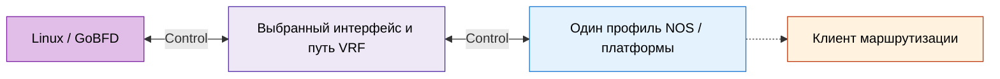

# Оборудование пиров и нормативные источники

Настройте одинаковый профиль BFD на обоих концах. Общий номер RFC не
подтверждает совместимость конкретных ASIC, версии NOS, интерфейса,
семейства адресов или режима аутентификации. Зафиксируйте эти параметры
в результате проверки; сохраните захват пакетов и состояние маршрута клиента.

## Контракт протокола

| Профиль | Контракт | Справочник GoBFD |
|:---|:---|:---|
| Асинхронный Control | [RFC 5880 §§6.8–6.8.7](https://datatracker.ietf.org/doc/html/rfc5880#section-6.8): состояния, таймеры, Poll/Final | [Протокол](../02-protocol.md) |
| IP single-hop | [RFC 5881 §§4–5](https://datatracker.ietf.org/doc/html/rfc5881#section-4): UDP/3784, TTL/Hop Limit 255, демультиплексирование | [Матрица RFC](../08-rfc-compliance.md) |
| IP multihop | [RFC 5883 §§3–5](https://datatracker.ietf.org/doc/html/rfc5883#section-3): UDP/4784, аутентификация и ограничение пути | [Конфигурация](../03-configuration.md) |
| Реакция BGP | [RFC 5882 §3.2](https://datatracker.ietf.org/doc/html/rfc5882#section-3.2): клиент владеет реакцией и политикой административного состояния | [Интеграции](../11-integrations.md) |
| LAG по участникам | [RFC 7130](https://datatracker.ietf.org/doc/html/rfc7130): сессии участников и допуск к передаче | [Граница Micro-BFD](../08-rfc-compliance.md) |
| Состояние сервиса anycast | [RFC 4786 §4.4.1](https://datatracker.ietf.org/doc/html/rfc4786#section-4.4.1): доступность сервиса и политика маршрута | [Статус](../roadmap.md) |

### Таймеры и единицы

Конфигурация GoBFD использует длительности вида `300ms`; поля интервалов
BFD на проводе — микросекунды. Единицы vendor CLI зависят от команды.
Приведите их к одной размерности перед сравнением с пакетами.

Для асинхронной сессии в Up рассчитывайте направления отдельно:

```text title="asynchronous-timer-equations"
TX_A = max(A.desired_min_tx, B.required_min_rx)
DETECTION_A = B.detect_mult * max(A.required_min_rx, B.desired_min_tx)
DETECTION_B = A.detect_mult * max(B.required_min_rx, A.desired_min_tx)
```

| Сторона | Desired TX | Required RX | Множитель |
|:---|---:|---:|---:|
| A | 100 мс | 300 мс | 5 |
| B | 200 мс | 500 мс | 3 |

Результат примера: `TX_A=500ms`, `DETECTION_A=900ms`,
`DETECTION_B=2500ms`. Эти сроки протокола не включают задержку действия
клиента и сходимость маршрутов. Переходы Poll/Final, частота запуска и jitter
передачи имеют отдельные правила RFC 5880. Номинальный интервал не задаёт
жёсткую гарантию полного времени переключения.

## Документы производителей

Это справочники конфигурации, а не доказательства квалификации GoBFD.
Проверьте поддержку точной модели и версии NOS перед применением примера.

| Семейство и документ | Проверка перед включением | Проверка без изменения |
|:---|:---|:---|
| [Cisco Nexus 9000 / NX-OS 10.5(x), BFD](https://www.cisco.com/c/en/us/td/docs/dcn/nx-os/nexus9000/105x/configuration/interfaces/cisco-nexus-9000-series-nx-os-interfaces-configuration-guide-release-105x/m_configuring_bidirectional_forwarding_detection_93x.html) | Политика Echo, привязка BGP, ограничения интерфейса и multihop | `show bfd neighbors details` |
| [Cisco IOS XE, диагностика BFD](https://www.cisco.com/c/en/us/support/docs/ip/ip-routing/220364-troubleshoot-bidirectional-forwarding-de.html) | Применяйте процедуры IOS XE; синтаксис NX-OS — отдельный контракт | Используйте описанную диагностику сессии и интерфейса |
| [Arista EOS, руководство BFD](https://www.arista.com/en/um-eos/eos-bidirectional-forwarding-detection) | Таймеры интерфейса, BGP `neighbor bfd`, независимый offload Control/Echo | `show bfd peers detail` |
| [Juniper Junos, BFD для BGP](https://www.juniper.net/documentation/us/en/software/junos/bgp/topics/topic-map/bfd-for-bgp-session.html) | Поведение платформы, привязка клиента, аутентификация и взаимодействие с restart | `show bfd session extensive` |
| [Junos, справочник BGP CLI](https://www.juniper.net/documentation/us/en/software/junos/cli-reference/topics/ref/statement/bfd-liveness-detection-edit-protocols-bgp.html) | Явный режим сессии, интервалы, множитель и hold-down | Проверьте действующую иерархию `bfd-liveness-detection` |
| [Huawei, установление BFD](https://info.support.huawei.com/info-finder/encyclopedia/en/detail?action=queryEntityDetail&keyword=BFD) | Статические и динамически изучаемые дискриминаторы | Зафиксируйте модель установления |
| [Huawei Cloud Direct Connect, BFD FAQ](https://support.huaweicloud.com/intl/en-us/dc_faq/dc_07_0212.html) | Параметры сервиса и проверка дискриминаторов | `display bfd session all` |

В руководстве EOS `bfd interval` задаётся в миллисекундах. Руководство
NX-OS указывает Echo включённым по умолчанию; EOS — выключенным.
Задавайте общий Control-only профиль явно при квалификации GoBFD Control.
RFC 9747 Unaffiliated Echo — отдельная возможность GoBFD; она не подтверждает
контракт affiliated Echo оборудования.

Параметры Huawei Cloud относятся к этому сервису, а не ко всем устройствам
Huawei VRP. Для Junos проверьте поддержку платформы и выбранного режима сессии
по указанным документам.

## Изолированная квалификация



1. Зафиксируйте commit GoBFD, версию NOS, модель, тип интерфейса, namespace/VRF,
   локальный и удалённый адреса, точку захвата пакетов.
2. Выберите IPv4 или IPv6, single-hop или multihop, Control или отдельно
   поддерживаемое расширение. Согласуйте единицы таймеров, алгоритм, key ID
   и модель установления дискриминаторов. Сохраните действующую конфигурацию.
3. Явно привяжите клиент маршрутизации. Проверьте согласованные интервалы,
   оба дискриминатора, состояния сторон и аутентификацию в захвате пакетов.
4. Внесите один отказ в изолированный путь. Измерьте потерю пакетов, owner Down,
   действие клиента и отзыв маршрута отдельными временными отметками.
5. Восстановите исходный путь. Проверьте сессию и ожидаемое состояние маршрута.
   Удалите тестовую конфигурацию по проверенной процедуре отката устройства.
6. Сохраните команды, итоговый код завершения, исходный захват и ограничения
   ресурсов. Повторите проверку для каждого заявленного профиля и финального кандидата.

Для облачного пути включите в описание окружения правила security group/ACL,
MTU, асимметрию маршрутов, проверку source address и планирование виртуальной
NIC. Это входные условия квалификации, а не предполагаемые функции провайдера.
Сессия VM или контейнера не подтверждает выбор физического участника LAG,
аппаратный offload или обнаружение отказа всего устройства.

Наборы проверок GoBFD и условия их допуска описаны в
[Совместимости](../05-interop.md). Ссылка на руководство, файл топологии или
исторический PASS не заполняют актуальную матрицу поддержки.
