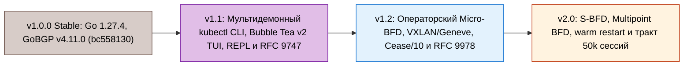

# Статус квалификации выпуска

[Английский оригинал](../en/roadmap.md).

Срез: **2026-11-28**. Страница фиксирует пострелизную техническую границу
квалификации после `v1.0.0` и ориентиры развития ветки `dev`; она не расширяет
заявленные гарантии выпуска сверх [матрицы соответствия RFC](08-rfc-compliance.md).

## Исходная база

Опубликованная база `v1.0.0`:
[`bc558130d37e489939f4b8764b6a9d1b568861da`](https://github.com/dantte-lp/gobfd/commit/bc558130d37e489939f4b8764b6a9d1b568861da)
в ветке `release/v1.0` (аннотированный тег `v1.0.0` на
`1cac85e8083b38717066769f2db7b0d62ad7f11d`, синхронизированный с `master` на
[`3bcdea03d3f05f21b14dd2a785e20805f642bf5f`](https://github.com/dantte-lp/gobfd/commit/3bcdea03d3f05f21b14dd2a785e20805f642bf5f)),
включающая Go `1.27.4`, GoBGP `v4.11.0`, сохранение владения Unix-сокетом по
ADR-0013, выпуск линии `v1.0` на GoBGP v4 по ADR-0014, медленный темп Echo по
RFC 9747, ресинхронизацию потерь Micro-BFD и контроль готовности `enforce`,
лимит неактивных peer-метрик Prometheus, очистку run-owned и stage-образов
Compose, прямой импорт в containerd по gRPC с lease для Kubernetes и без-Bash
оркестрацию `Makefile`/OCI. Стабильные ветки, релизные теги и backup refs
сохранены.

## Приёмка стабильной v1

| Область | Реализовано | Остаток приёмки |
|:---|:---|:---|
| Нагрузка Control | Реальные owner/peer и учёт терминальных исходов | Калиброванные native-распределения и полный эталонный прогон |
| Эталонное окружение | Изолированный Debian runner; проверки идентичности, часов и допуска | Допуск канонических ресурсов и квалифицированные измерения нагрузки |
| Профили давления | Драйверы CPU, GC, scheduler, loss и session churn | Измерения на допущенных эталонных ресурсах |
| Нагрузка Echo | Реальные возвраты и owner Down witnesses | Native-приёмка масштаба, таймингов и ресурсов |
| Reload с сохранением сессий | Реализация и ограниченные проверки пакетов | Единая проверка пяти полей на точном финальном кандидате с поддерживаемыми пирами |
| Безопасность | Ограниченные исключения зависимостей и защита управления | Advisory, достижимость и безопасность финального кандидата stable v1 |
| Документация | EN/RU-руководство с исходными ссылками и ADR | Независимая сверка содержания, ссылок и эквивалентности языков |

По [ADR-0014](adr/0014-v1-gobgp-v4-release-line-baseline.md) ветка
`release/v1.0` переводится к выпуску `1.0.0` как новой продуктовой линии под
GoBGP v4 с сохранением явных границ preview/experimental в
[матрице покрытия RFC](08-rfc-compliance.md); пользователи GoBGP v3 остаются на
`release/v0.6`. Многочасовые 24-часовые soak-кампании, масштабные нативные
прогоны Control/Echo и проверки на внешних аппаратных NOS учитываются отдельно
как эксплуатационные доказательства вне первичного выпуска ветки `1.0.0`.
Условия измерения заданы в [Производительности](14-performance-analysis.md) и
[Совместимости](05-interop.md).

## Каналы выпуска и история prerelease

[ADR-0008](adr/0008-experimental-prerelease-boundary.md) фиксирует историческую
границу предварительного канала `v1.0.0-alpha.N` от 2026-10-30, а
[ADR-0014](adr/0014-v1-gobgp-v4-release-line-baseline.md) переводит
`release/v1.0` на предложение стабильного выпуска `1.0.0` от 2026-11-27.
Release Please готовит проверяемый PR выпуска; GoReleaser и независимая
проверка отвечают за создание черновика и публикацию. Принятие политики не
означает опубликованный выпуск до слияния проверенного PR выпуска и прохождения
аннотированным тегом `release.yml`.

## Дорожная карта развития продукта (`dev`)

Развитие в ветке `dev` организовано в три продуктовых горизонта после `v1.0.0`, тогда как ветка `release/v1.0` принимает только исправления ошибок и уязвимостей:

| Горизонт | Направление | Запланированные возможности в `dev` | Ворота квалификации |
|:---|:---|:---|:---|
| `v1.1` | Мультидемонный операторский CLI, TUI, REPL и завершение `RFC 9747` | Аддитивный read-only сервис интроспекции `bfd.v1.DaemonService` (версия/аптайм демона, готовность сокетов и потери `SO_RXQ_OVFL`, `GOMEMLIMIT`/горутины/потоки ОС, квантили задержек, эпоха спикера / `PeerAdminState` / демпфирование `GoBGP v4`, кольцевой буфер последних переходов); `kubeconfig`-подобные контексты демонов (`$XDG_CONFIG_HOME/gobfd/config.yaml`, `--context`, `-A`, метки `-l`) и команды в стиле `kubectl` (`get`, `describe`, `top`, `events` с `-o wide` и `--field-selector`); полноэкранный `gobfdctl tui` (`charm.land/bubbletea/v2` `v2.2.0`, `lipgloss/v2` `v2.1.1`, `bubbles/v2` `v2.2.2`, по умолчанию read-only); полнофункциональный `gobfdctl shell` (`reeflective/console` + динамическое RPC-автодополнение `carapace`, индикатор контекста и здоровья в приглашении, история `0600` с фильтрацией секретов, отмена потоков по `Ctrl-C`); отправка Echo через Linux `AF_PACKET` (`#126`), 3-состоятельный FSM Echo `RFC 9747` (`#125`) и связка L4/HTTP-здоровья с anycast `GoBGP v4` (`#88`) | Обратная совместимость флагов `v1.0`, headless-тесты TUI, мультидемонные E2E mTLS/Unix и PCAP Echo с FRR/BIRD |
| `v1.2` | Операторские LAG/оверлеи, `RFC 9384` и экспериментальные RFC 2026 года | `RFC 7130` Micro-BFD с multicast MAC `01:00:5E:90:00:01`, передачей на порабощённых участниках kernel-bond и двухстековыми группами LAG; динамическое включение/выключение дополнения и DF по `RFC 9764` и бесшовная ротация `AuthKeyID`; отправка подкода BGP `NOTIFICATION` Cease/`10` по `RFC 9384` через GoBGP v4; совместное владение туннелями Linux/OVS/CNI для `RFC 8971` VXLAN и `RFC 9521` Geneve; опциональный счётчик `RFC 9978` `lost_packets_total` (`delta - 1` + 64-битная маска перестановок) и опциональный `RFC 9985`/`9986` `Meticulous Keyed ISAAC` (`DetectMult <= 85`) | Захваты PCAP, побитовое совпадение KAT Table 2 `RFC 9986`, совмещение трафика данных и OAM в туннелях |
| `v2.0` | Seamless/Multipoint BFD, бесшовный перезапуск и тракт `50k+` сессий | `RFC 7880`–`7886` `S-BFD` (отражатель и инициатор `UDP/7784`); `RFC 8562`/`8563`/`9780` Multipoint BFD (`MultipointHead`/`MultipointTail`); бесшовная передача состояния при обновлении демона (`SCM_RIGHTS` для сокетов + перенос сессий и sequence numbers); защищённый ADR пакетный/ядерный быстрый путь (`recvmmsg`/`sendmmsg`, шардированное колесо таймеров, опциональный `eBPF`/`XDP` и `io_uring`) на `50 000+` сессий на узел | Принятые ADR с бенчмарками, `0` сбросов BGP при обновлении бинарника, совместимость S-BFD |

## Дополнительная область

| Возможность | Граница |
|:---|:---|
| Мультидемонный `kubectl`-подобный CLI, TUI и полный REPL | Запланировано в `dev` (`v1.1`): в `v1.0.0` `gobfdctl` обращается к одной конечной точке `--addr` без TUI и контекстов нескольких демонов |
| Полный профиль RFC 9747 Unaffiliated Echo (`#125`, `#126`) | Запланировано в `dev` (`v1.1`): отправка через `AF_PACKET` на MAC соседа (`rfc5881bis-02` §2), 3-состоятельный FSM `Down -> Init -> Up`, демультиплексирование `YourDiscriminator` и аутентификация возврата |
| Состояние HAProxy как политика anycast VIP (`#88`) | Не реализовано; существующий агент передаёт BFD в HAProxy; обратное управление маршрутами GoBGP v4 по L4/HTTP-проверкам с `hold-down` запланировано в `dev` |
| Экспериментальные RFC 2026 года (`RFC 9978`, `RFC 9985`/`9986`) | Не реализовано; оконный счётчик потерь `RFC 9978` `lost_packets_total` (`delta - 1` с защитой от перестановки) и оценка `RFC 9986` ISAAC ведутся в `dev` (`v1.2`) |
| Расширенный ExaBGP process API | Native anycast-цикл не квалифицирует ACK/reload, JSON/EOR и полную dual-stack-матрицу |
| Проверка pending-интерфейсов | Отделена от реализованной основной pending-активации |
| Глобальные VNI defaults в runtime | Отделены от startup defaults |

Для service-driven anycast [RFC 4786 §4.4.1](https://datatracker.ietf.org/doc/html/rfc4786#section-4.4.1)
задаёт рекомендации по доступности. Настраиваемый hold-down и явный владелец
маршрута — требования проекта. Не использовать BFD AdminDown как переносимую
команду отзыва маршрута; реакция клиента определяется отдельно.

## Различия линий сопровождения

| Ветка | Контракт |
|:---|:---|
| `dev` | Следующая продуктовая линия; приёмка исходников не подтверждает стабильную поставку |
| `master` | Последнее принятое стабильное состояние |
| `release/v1.0` | Поддерживаемый публичный контракт v1.0 и зависимость GoBGP v4 |
| `release/v0.6` | Поддерживаемый публичный контракт v0.6 и зависимость GoBGP v3 |

[Процесс выпуска](10-changelog.md) задаёт квалификацию, changelog, ruleset,
точный тег и проверку draft-артефактов. Oracle Linux 10 исключён из OCI-продуктов
v1; Debian trixie и генерация обычного RPM сохраняют отдельные контракты.
Сохранять существующие артефакты и теги v0.6.

## Исторические записи

Предыдущий накопленный статус и точные доказательства сохранены
[в базе интеграции](https://github.com/dantte-lp/gobfd/blob/eae8f0636055de8ac4714199e27ff0c9d18b9859/docs/ru/roadmap.md).
Датированные проверки находятся в [пострелизной ретроспективе и формальном аудите RFC от 2026-11-28](audits/2026-11-28-v1-post-release-retrospective-and-formal-rfc-audit.md),
[ретроспективе от 2026-11-27](audits/2026-11-27-release-retrospective.md),
[ретроспективе от 2026-10-26](audits/2026-10-26-release-retrospective.md)
и [сверке внешнего аудита](gist-audit-reconciliation.md). Исторические результаты
не являются новыми измерениями текущего кандидата.
