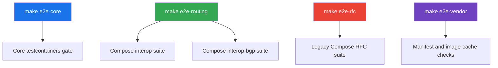

# S10 E2E Target Inventory

Current test and integration targets mapped to the S10 E2E evidence model.

The inventory records current source behavior, not passing runtime acceptance.
S10 labels classify related evidence; they do not imply that one Make target
invokes another. Sources: [`Makefile`](../../Makefile),
[`e2erunner`](../internal/e2erunner/runner.go) and
[`integrationrunner`](../internal/integrationrunner/runner.go).
Русские руководства: [interop](../../docs/ru/05-interop.md),
[разработка](../../docs/ru/09-development.md) и
[интеграции](../../docs/ru/11-integrations.md).

---

## Inventory

The five `e2e-routing`, `e2e-rfc`, `e2e-overlay`, `e2e-linux` and `e2e-vendor`
launchers rebuild ignored `bin/e2ectl` in the existing digest-pinned compiler
image without an engine socket, then execute it on the host. A checkout-local
directory lock serializes their dev recreation, compilation and runtime.
This launcher boundary does not qualify the payloads listed below.

| Current Target | S10 Target | Owner | Runtime | Network | Inputs | Outputs | Cleanup | Current Gap |
|---|---|---|---|---|---|---|---|---|
| `make e2e-core` | `e2e-core` | Core E2E stack | Container-built `e2ectl`; race-enabled testcontainers-go with Podman | `172.30.10.0/24` | GoBFD A/B, static simple-password auth, gobfdctl, metrics, reload, tshark | Go test JSON/log, bounded diagnostics, container logs/state, metrics checks, pcapng, packet CSV/TSV, summary | Exact test-owned container, network, and image cleanup | `make e2e-core-testcontainers` is the underlying gate; artifacts use `reports/e2e/core/run.*`. |
| `make test-integration` | `e2e-core` input | Go integration tests | Dev container | In-process HTTP/test server | Go test package `./test/integration` | Verbose Go test output | Go test cleanup | No daemon-to-daemon packet evidence. |
| `make e2e-routing` | `e2e-routing` | Go `e2ectl` routing aggregate | Podman Compose plus dev container Go test | `172.20.0.0/24`, `172.21.0.0/24` | `test/interop`, `test/interop-bgp`, tshark | Aggregate Go test JSON/log, container logs/state, merged pcapng, packet CSV, suite artifacts | `interopproject.Controller` holds one flock per exact Compose project, validates labels and fixed names, and removes exact resource snapshots; the merge container uses a unique non-Compose ownership label | Implemented for existing routing interop suites through the shared Go lifecycle API. |
| `make interop` | Routing-domain gate | BFD interop stack | Dev-container race tests; Go-owned Podman testcontainers | `172.20.0.0/24`; separate crafted profiles | GoBFD, FRR, BIRD3, Holo, Holo loader, Thoro/bfd, tshark, Go BFD invalid-vector generator; meticulous, BIRD and crafted/TTL profiles | Go test output, retained packet/config/receipt artifacts | Exact Compose project label and exact test-owned resource cleanup | Independent full-cycle gate; `e2e-routing` instead invokes the Compose suite directly and does not select every profile. |
| `make interop-bgp` | Routing-domain gate | BGP+BFD interop stack | Dev-container race tests; Go-owned Podman testcontainers | `172.21.0.0/24` | GoBFD, GoBGP, FRR, BIRD3, ExaBGP, tshark | Go test output, BGP/BFD state and retained PCAP | Exact test-owned resource cleanup | Independent full-cycle gate; `e2e-routing` uses its separate Compose lifecycle. |
| `make e2e-rfc` | `e2e-rfc` | Legacy RFC aggregate | Podman Compose plus dev-container Go tests without `-race` | `172.22.0.0/24` | RFC 7419, 9384, 9468, 9747 scenarios | Go test JSON/log, best-effort diagnostics and capture, summary | Best-effort `down --volumes --remove-orphans` | Fixed names and uncapped Compose builds; separate `make interop-rfc` is the race-enabled testcontainers gate. |
| `make e2e-overlay` | `e2e-overlay` | Overlay boundary E2E | Prebuilt race test in a 2 CPU / 2 GiB Podman container | Isolated `--network none` loopback | VXLAN, Geneve Format A, reserved backend matrix | Go test JSON/log, container inspect/logs, synthetic codec CSV, summary | Exact created-container removal; image volumes ignored | Actual UDP tuple and lifecycle checks; external bounded capture remains required for wire qualification. |
| `make e2e-linux` | `e2e-linux` | Linux dataplane ownership E2E | Compiled Go test binary in isolated Podman `--network none` container | Disposable container netns and fake sysfs | rtnetlink veth up/down, kernel-bond fake sysfs, OVS owner-policy guard, NetworkManager D-Bus owner-policy guard | Go test JSON/log, container logs/state, link event JSON, LAG backend JSON, summary | Container removal by runner cleanup | Implemented for isolated Linux ownership boundaries. |
| `make interop-rfc` | RFC-domain gate | RFC interop stack | Dev-container race tests; Go-owned Podman testcontainers | `172.22.0.0/24` | RFC 7419, 9384, 9468, 9747 scenarios | Go test output, retained PCAP and container evidence | Exact test-owned resource cleanup | Independent gate; RFC 9384 action-path checks do not prove wire subcode 10. |
| `make interop-clab` | `e2e-vendor` input | Vendor NOS profile | Podman and containerlab | Containerlab topology | Primary cEOS, SR Linux, SONiC-VS, VyOS; baseline FRR; deferred XRd where images exist | Go test output and vendor command output | containerlab destroy and Podman cleanup | Manual topology execution remains image/license dependent. |
| `make e2e-vendor` | `e2e-vendor` | Vendor manifest evidence | Container-built host `e2ectl`; dev-container Go tests | Profile manifest and image cache; no NOS topology | Primary Arista cEOS, Nokia SR Linux, SONiC-VS, VyOS; baseline FRR; deferred Cisco XRd | Go test JSON/log, dev-stack diagnostics, vendor profiles, image availability, skip summary | No vendor topology created | Manifest/configuration checks and cached-image inspection only; passing results do not qualify vendor interoperability. |
| `make int-bgp-failover` | `e2e-routing` input | BGP fast-failover Go gate | Go 1.27 testcontainers-go with the Podman provider | `172.22.0.0/24` | GoBFD, GoBGP v4.10.0, FRR 10.7.1, tshark; shared trixie peers | Go test JSON/log, bounded diagnostics, container logs/state, pcapng, packet CSV, summary | Exact test-owned container, network, image-tag, and content-ID cleanup | Bounded builds/runtime; the operational Compose example uses the ownership-checked Go controller through `-up`, `-logs`, and `-down`. |
| `make int-haproxy` | Related standalone demo | Integration example | Host Go runner plus Podman Compose | Example-local network | GoBFD, HAProxy, tshark | Demo observations; capture is not retained as an S10 report | `down --volumes --remove-orphans` | Warning-only observations and obsolete `sessions` probe; separate `make int-haproxy-testcontainers` produces assertion-based reports. |
| `make int-observability` | Related standalone demo | Integration example | Host Go runner plus Podman Compose | Example-local network | GoBFD, Prometheus, Grafana, FRR, tshark | Displayed metrics/alerts; no S10 report retention | `down --volumes --remove-orphans` | Warning-only checks; separate `make int-observability-testcontainers` asserts alert firing and recovery. |
| `make int-exabgp-anycast` | Related standalone gate | Integration example | Host Go runner plus guarded Compose controller | Example-local network | GoBFD, GoBGP, ExaBGP, tshark | Route announce/withdraw/restore assertions and displayed packet output | Exact controller-owned resource cleanup; built images retained | Not invoked by `e2e-routing`; no S10 report directory. |
| `make int-k8s` | Manual example | Kubernetes integration | Host Go runner, Podman builds, existing k3s | Cluster-owned host network | GoBFD/GoBGP images and manifests | Local-node image import, Kubernetes resources and logs | `make int-k8s-down` deletes namespace `gobfd`, preserving the host cluster | Local-only image import, label mismatch and obsolete probes remain unqualified; namespace deletion requires ownership and approval. |

`TestSameKeyFRRTestcontainers` is the separate FRR-only retirement gate. It
reuses the GoBFD, FRR and TShark helpers with one API-owned session, retaining
old/new wire epochs, API conflicts, sender socket lifetime and peer recovery.
Full peer-matrix and native scale acceptance remain separate gates.

## S10 Mapping

## S10 Status

| Item | Status |
|---|---|
| Worktree-safe dev Compose project | Implemented in S10.1. |
| Fixed dev `container_name` removed | Implemented in S10.1. |
| `make e2e-help` | Implemented in S10.1. |
| Non-implemented S10 targets fail closed | Implemented in S10.1; no S10.6 aggregate placeholder remains. |
| Standard artifact directory contract | Implemented in S10.1 and applied by `make e2e-core` in S10.2. |
| Core daemon E2E | Implemented in S10.2. |
| Routing interop aggregate | Implemented in S10.3. |
| RFC interop aggregate | Implemented in S10.4. |
| Overlay backend boundary checks | Implemented in S10.4. |
| Linux dataplane ownership checks | Implemented in S10.5. |
| Vendor optional profiles | Manifest and cached-image evidence implemented; live topology belongs to `interop-clab`. |
| E2E CI artifact workflow | Implemented in S10.7. |
| Podman lifecycle helper extraction | Implemented for routing through `interopproject.Controller` and `e2ectl`. |
| Host `go test` removal from full-cycle runners | Core/report gates execute from the dev container; routing/RFC/vendor tests execute in dev, overlay/Linux execute compiled tests in isolated containers; five aggregate wrappers execute container-built host `e2ectl` without host Go. |

---

*Source review: 2026-10-25; no runtime execution in this documentation review.*
